<div align="center">

<picture>
  <source media="(prefers-color-scheme: dark)" srcset="assets/logo-dark.svg">
  
</picture>

# Toolbench

**Ship small interactive tools on a website.**
A tool is one function and one JSON file. Toolbench builds the form, runs it, and renders the result.

**[Try it](https://eknowledger.github.io/toolbench/gallery.html).** Every feature, live, no clone required.

<!-- ⚠️ All badges in a group must sit on ONE source line. GitHub renders a single newline as <br>, so
     one badge per line stacks them vertically instead of flowing them inline. -->

[](https://github.com/eknowledger/toolbench/actions/workflows/tests.yml) [](https://github.com/eknowledger/toolbench/actions/workflows/build.yml) [](https://www.npmjs.com/package/@toolbench/runtime) [](LICENSE)

[](docs/versioning.md) [](#size-and-cost) [](#install) [](packages/sdk/src/types.ts) [](#browser-and-runtime-support) [](CONTRIBUTING.md)

</div>

```ts
// tools/reverse/index.ts
import type { Tool } from "@toolbench/sdk";

export default {
  run({ text }) {
    return { kind: "fields", fields: [{ label: "reversed", value: [...text].reverse().join("") }] };
  },
} satisfies Tool<{ text: string }>;
```

```html
<tool-host tool="reverse" mode="card"></tool-host>
```

The tool has no idea it is on the web. The website needs no framework.

## Contents

- [Live demo](#live-demo)
- [What it looks like](#what-it-looks-like)
- [Why](#why)
- [Install](#install)
- [Quick start](#quick-start)
- [Display modes](#display-modes)
- [How a tool runs](#how-a-tool-runs)
- [Result shapes](#result-shapes)
- [Worker mode](#worker-mode)
- [Theming](#theming)
- [Size and cost](#size-and-cost)
- [Browser and runtime support](#browser-and-runtime-support)
- [Non-goals](#non-goals)
- [Repository layout](#repository-layout)
- [Documentation](#documentation)

## Live demo

The project site, built from `site/`, is at
[eknowledger.github.io/toolbench](https://eknowledger.github.io/toolbench/). Its
[gallery](https://eknowledger.github.io/toolbench/gallery.html) runs every feature beside the code
that produces it:

| Section | What it shows |
|---|---|
| [Display modes](https://eknowledger.github.io/toolbench/gallery.html#modes) | A tool on its own page, a card that loads nothing until it is opened, and a tool inside an article |
| [Inputs](https://eknowledger.github.io/toolbench/gallery.html#inputs) | Samples, select presets, a slider, a highlighted textarea, help text with lists, code and tones, details behind a disclosure, and `autoRun` |
| [Running and failing](https://eknowledger.github.io/toolbench/gallery.html#running) | Worker mode with a timeout, a tool that spins, throws or rejects its input, and the `deprecated` and `retired` states |
| [Charts](https://eknowledger.github.io/toolbench/gallery.html#charts) | Every chart kind, each with the result that draws it |

The bench in `bench/` is the browser suite's fixture rather than a demo, and is not published. It runs
locally with `pnpm bench`, on http://localhost:5180.

A maintainer enables the site once: **Settings → Pages → Source → GitHub Actions**.
The workflow is [`.github/workflows/pages.yml`](.github/workflows/pages.yml). Until
that toggle is flipped, the try-it URL 404s. Flipping it is the remaining click.

## What it looks like

Every screenshot below is the test bench in `bench/`, which is the same runtime a host installs. Nothing
is mocked up.

### A card costs nothing until someone opens it

On the left the card is **static markup**: a result computed at build time by `seed()`, with not one byte
of the tool's code downloaded. On the right, the same card after one click.

<table>
<tr>
<td width="50%">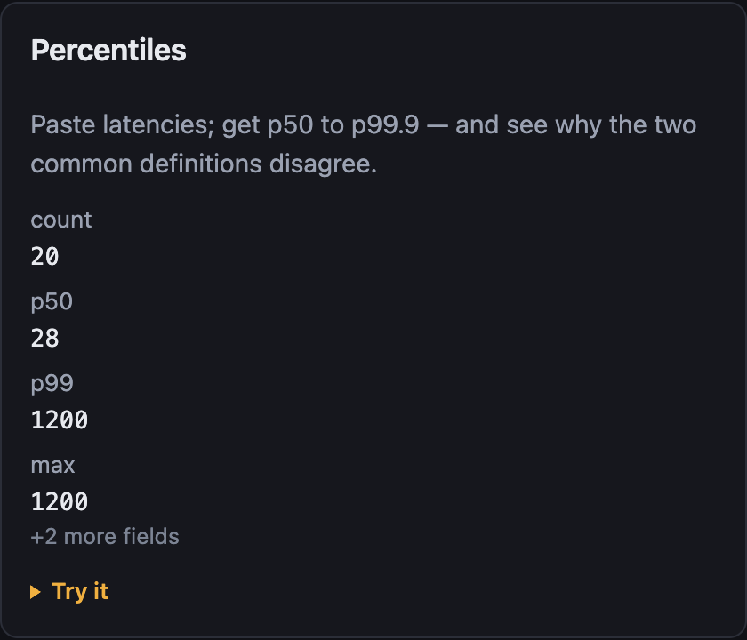</td>
<td width="50%">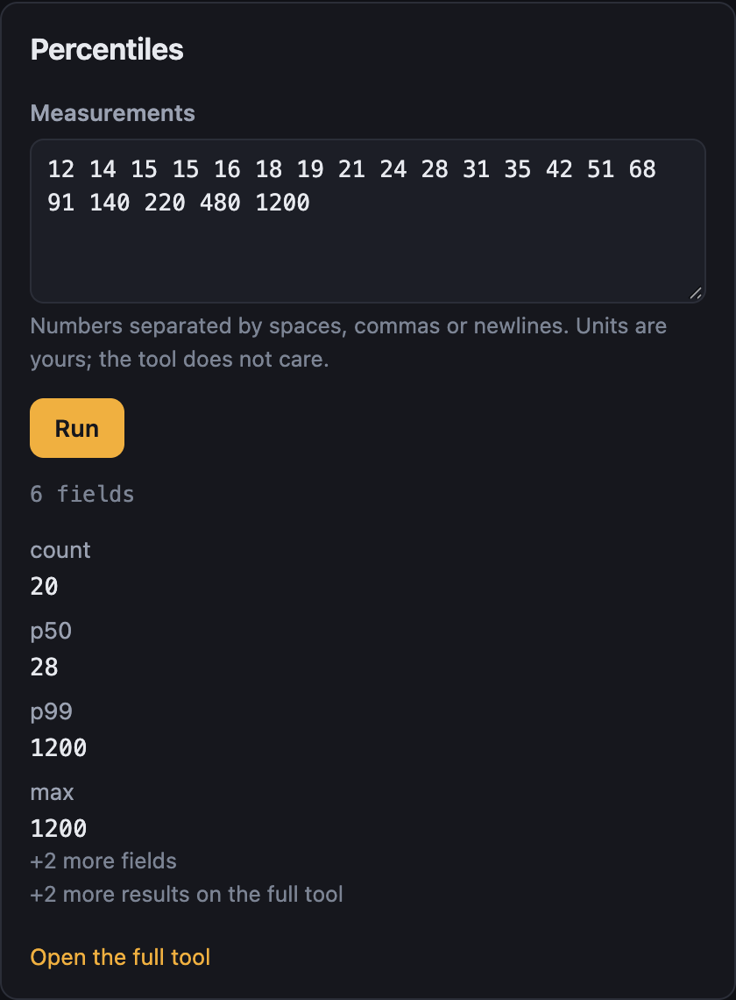</td>
</tr>
<tr>
<td align="center"><em>Closed: markup only, 0 bytes of tool code</em></td>
<td align="center"><em>Opened: one chunk fetched, form generated from the manifest</em></td>
</tr>
</table>

### A tool ships its own examples

`samples` in the manifest becomes a row under the form. A click fills the inputs and stops there, because
Run is the trigger and a sample is an input change like any other: the answer already on screen dims to
say it belongs to the inputs that produced it, rather than being quietly replaced. Below, one click has
loaded ten measurements and switched the definition, and the figures underneath are still the previous
run's.

The one worth shipping is the example whose input the tool rejects. It is the one a reader will never type,
because nobody sits down to invent a broken input, and it is how a tool shows its failure path on purpose
rather than at the least convenient moment.

<table>
<tr>
<td>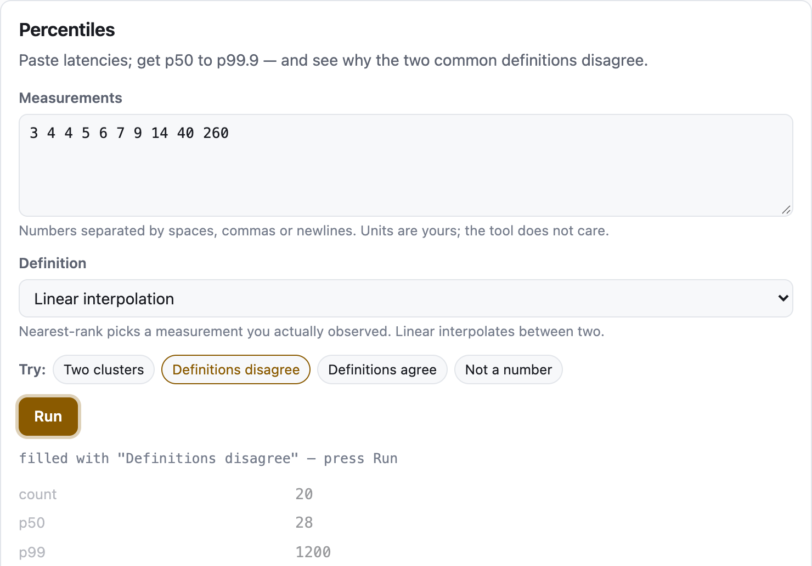</td>
</tr>
<tr>
<td align="center"><em>One click fills the form. The stale result stays put, so the old answer is still there to compare against</em></td>
</tr>
</table>

### Results are typed shapes, not HTML

A tool returns one of a closed set of shapes and the runtime draws it. Below is `bytes`, for wire
formats: offsets, hex, a printable gutter, and named ranges. The highlight on the four-byte character
**spans the row break**, which is what a table cannot do and why the kind exists.

The same tool in both themes. A tool inherits the page it is on; theming is a dozen CSS custom
properties and nothing else.

<table>
<tr>
<td width="50%">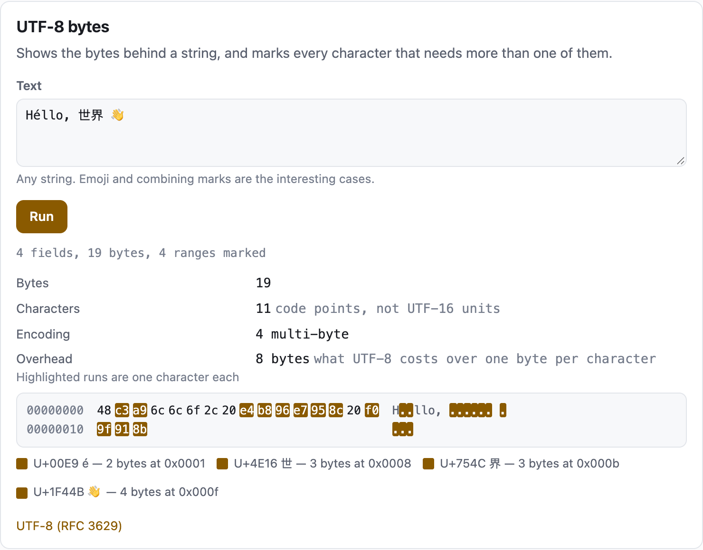</td>
<td width="50%">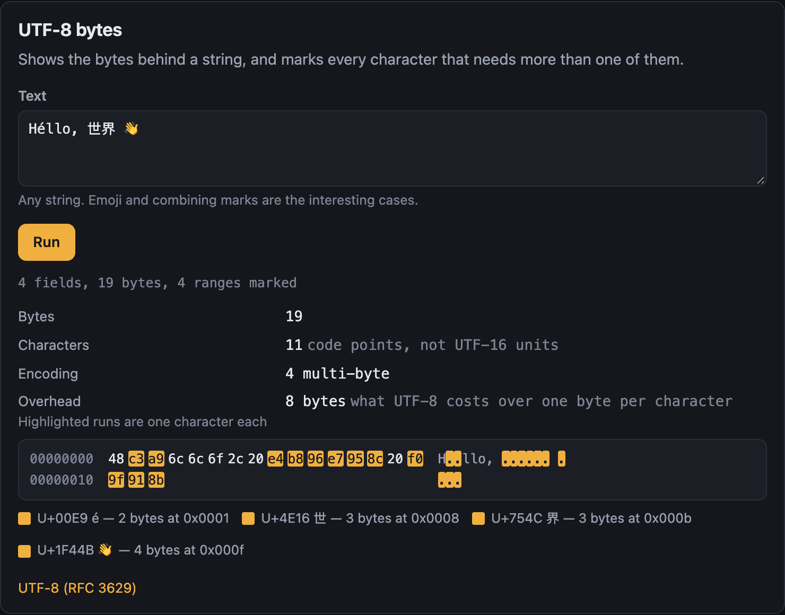</td>
</tr>
</table>

### A chart also ships its numbers

A chart is an image, and a screen reader gets nothing from an image. So every `series` result renders the
same data as a table inside a `<details>`, automatically. The tool author does nothing to get this.

<table>
<tr>
<td width="50%">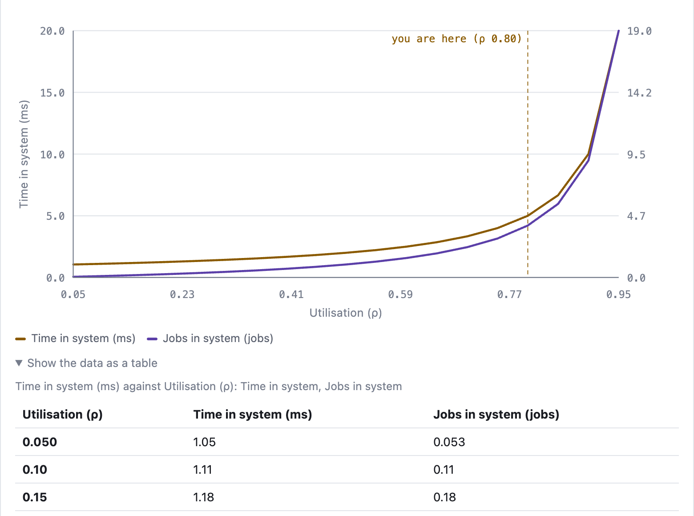</td>
<td width="50%">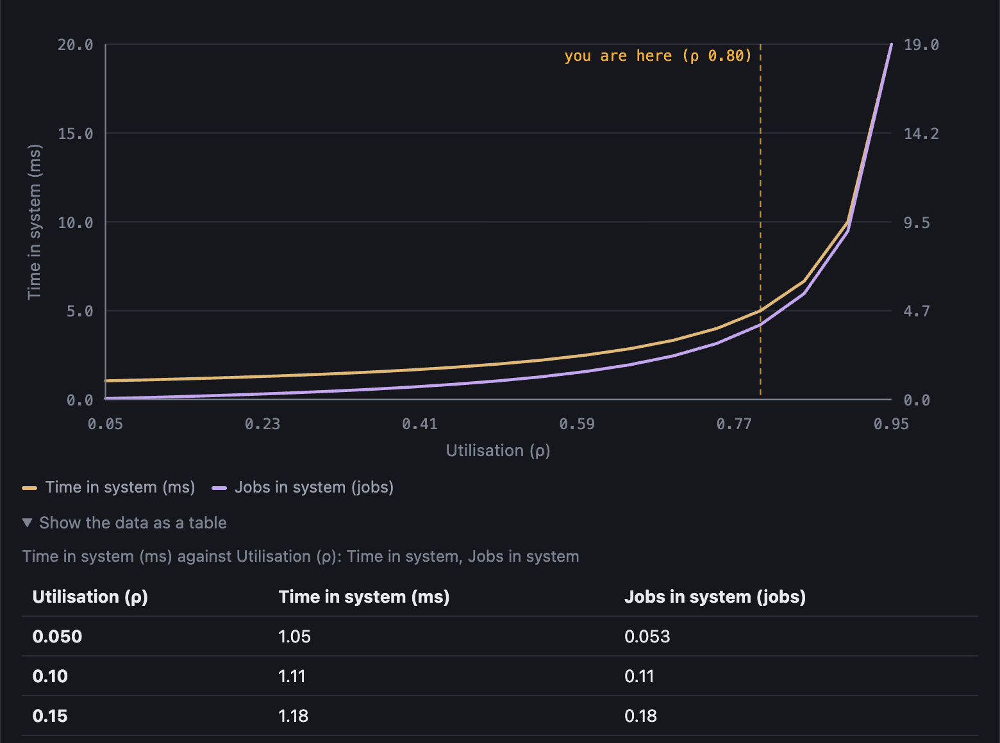</td>
</tr>
</table>

### A graph is laid out for you

A `graph` result says what is connected, and the runtime decides where everything goes: ranks, ports
centred on the side facing the other end, orthogonal edges that never share a stretch of line, labels clear
of everything. The same graph gives the same picture in Chrome, Firefox, WebKit and Node. Every edge is also
in a table under the picture, and the picture can be walked with the arrow keys.

<table>
<tr>
<td width="50%">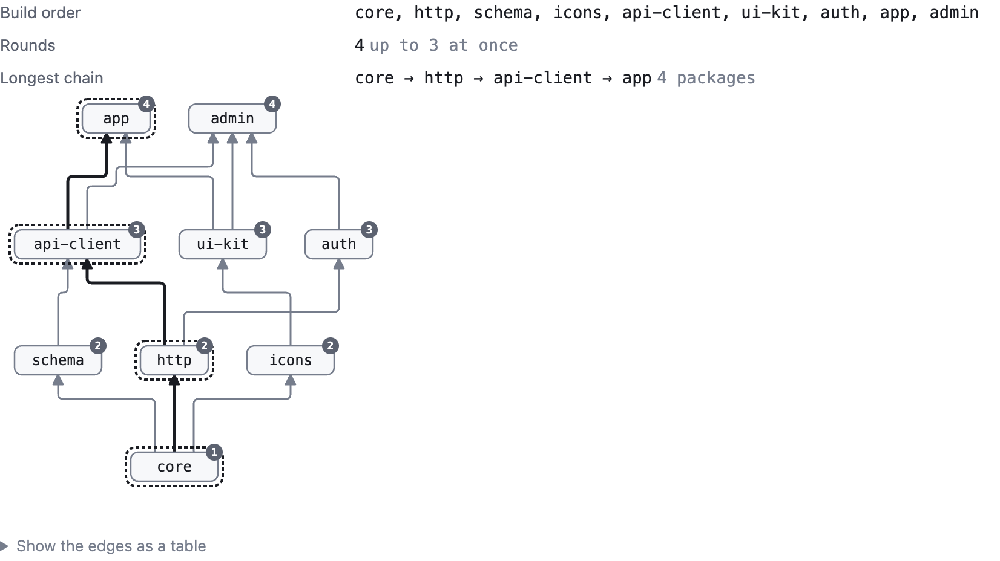</td>
<td width="50%">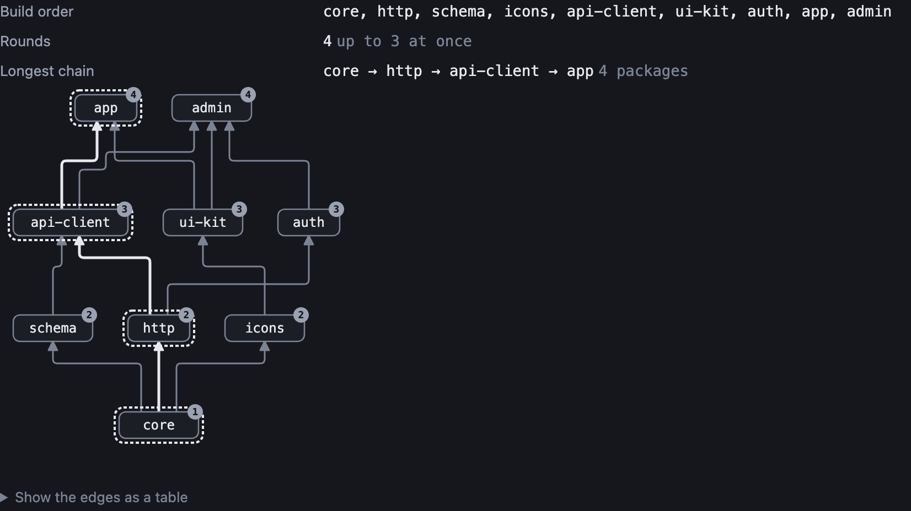</td>
</tr>
</table>

## Why

Interactive widgets on a website are usually one-offs: a script per widget, wired into one page by
hand. The second widget repeats the form handling, the error states, the loading behaviour and the
styling. By the fourth they have drifted apart, and none of them has tests.

Toolbench turns the shape of a tool into a contract. In exchange:

* **Fixtures are the test suite.** A tool ships known-answer cases that run in Node, with no browser
  and no build step. A broken tool fails your build instead of someone's afternoon.
* **One interface for every tool**, accessible by default: real labels, errors tied to the input that
  caused them, a status region, keyboard operation, reduced-motion support.
* **Nothing loads until it is needed.** A card downloads no tool code until someone opens it.
* **Old tools keep working.** The contract is versioned, changes are additive only, and compatibility
  is enforced by tests rather than intent. See [docs/versioning.md](docs/versioning.md).

## Install

```sh
pnpm add @toolbench/sdk @toolbench/runtime
```

`@toolbench/sdk` is what tool authors import. It has no dependencies and does not touch the DOM.
`@toolbench/runtime` is what the website imports. It has no dependencies either, and no framework.

## Quick start

Three steps. The result is a working tool page.

**1. Write the tool.** Four files in a directory:

```
tools/reverse/
  tool.json      identity, inputs, result shapes
  index.ts       the function
  cases.json     known-answer fixtures
  README.md      help text
```

```jsonc
// tools/reverse/tool.json
{
  "sdk": 1,
  "id": "reverse",
  "name": "Reverse text",
  "blurb": "Reverses a string. Handles emoji correctly, which is most of the interest.",
  "version": "1.0.0",
  "capabilities": ["pure"],
  "runtime": { "entry": "index.ts", "thread": "main" },
  "kinds": ["fields", "error"],
  "card": "live",
  "inputs": [
    { "id": "text", "type": "text", "label": "Text", "primary": true, "default": "hello" }
  ]
}
```

`sdk` is 1 on purpose, because a v1 manifest still being valid is the compatibility promise made
concrete: the current contract is 8, and declaring 1 opts out of everything added since (`bytes` in v2,
`samples` in v3, richer charts in v4, `role` and the `muted` tone in v5, select presets and highlighted textareas in v6, graphs and textarea grammars in v7, `mono` on a field and `share` on an input in v8). Using one of those means declaring its version: a manifest that uses a feature newer than its `sdk` is refused, with the field and the `sdk` to declare. See [docs/versioning.md](docs/versioning.md).

**2. Register it.** Once per site:

```ts
import { defineToolHost, RegistrySource } from "@toolbench/runtime";
import manifest from "./tools/reverse/tool.json";

defineToolHost({
  source: new RegistrySource({
    reverse: { manifest, load: () => import("./tools/reverse/index.ts") },
  }),
  pageUrl: (id) => `/tools/${id}/`,
  // Optional. Return a Node, never a string: the runtime will not assign innerHTML.
  // Paints `code` results, and textareas whose input declares `lang`.
  // highlight: (source, lang) => yourHighlighter(source, lang),
  // Optional. Your own CSS inside every tool, after the runtime's. See STYLING.md.
  // styles: [yourSheet],
  // Optional. A graph wider than its tool: "fit" (default) or "scroll", and whether the reader
  // gets a button to switch. See "A graph wider than its tool" below.
  // wide: "fit", wideToggle: true,
});
```

With a bundler that supports directory globs, the source is a loop over the glob instead of a literal
map. [`bench/src/registry.ts`](bench/src/registry.ts) is the version this repository uses, and it
picks up new tools with no code change.

**3. Put it on a page.**

```html
<tool-host tool="reverse" mode="page"></tool-host>
```

**4. Test it.** `cases.json` holds inputs and expected results:

```jsonc
[
  {
    "name": "reverses a string",
    "input": { "text": "abc" },
    "expect": { "kind": "fields", "fields": [{ "label": "reversed", "value": "cba" }] }
  }
]
```

```sh
node --test tools/cases.test.ts
```

On your own site that suite is three lines, since the directory walk is exported:

```ts
import { describe, it } from "node:test";
import { checkToolDirectory } from "@toolbench/sdk/fixtures";

checkToolDirectory(new URL("../src/tools/", import.meta.url), { describe, it });
```

It validates every manifest, checks each tool's `id` matches its directory, refuses an empty
`cases.json`, verifies no case expects a kind the manifest failed to declare, runs every case, and runs
every sample the manifest declares. Wire it into CI and a change that breaks a tool fails your build
instead of someone's afternoon.

Full walkthrough: [docs/authoring-a-tool.md](docs/authoring-a-tool.md).

## Display modes

One declaration drives three presentations. The mode also decides when the tool's code is fetched,
which is the difference between a page that stays fast and one that does not.

| `mode` | Shows | Fetches the tool's code |
|---|---|---|
| `card` | Name, blurb, the inputs marked `primary`, the first result part | When the reader opens it. Until then the card is static markup. |
| `page` | Every input, the full result, the tool's links | When it scrolls within two viewports |
| `embed` | Same as `page` without the title, sized for the middle of an article | When it scrolls within two viewports |

A card shows one result part by default, which is too few for a tool whose answer is a number *and* a
curve: the number alone hides how steep the curve is, and the curve alone is a set of unnamed lines. Give
the card more room with `parts`:

```html
<tool-host tool="queue-explorer" mode="card" parts="2"></tool-host>
```

An attribute rather than a manifest key, deliberately. How much room a card has is a property of the page
it sits on, not of the tool: the same tool is a one-part card in a sidebar and a two-part card leading a
section, and a manifest cannot know which. Whatever does not fit is counted, not hidden, and a compact
chart keeps its legend so its lines stay identifiable.

`parts` works in any mode, not only on a card. An embedded tool with no `parts` still shows everything,
because that is what it has always done and a cap nobody asked for would truncate existing pages on
upgrade.

### Letting the reader open the rest

In prose, "the first part, then a line pointing somewhere else" is the wrong offer: the reader is already
where they want to be. `more="expand"` turns that line into a button that reveals the rest **in place**.

```html
<tool-host tool="percentiles" mode="embed" parts="1" more="expand"></tool-host>
```

| `more` | The notice under a truncated result |
|---|---|
| `link` (default) | `+2 more results on the full tool`, as plain text. Right for a card, whose job is to send the reader to the page |
| `expand` | `Show 2 more results`, as a button. Pressing it reveals them here and changes the label to `Hide 2 results` |

Expanding **does not run the tool again**: the result is redrawn from the answer already in hand, so it
costs nothing even for a worker-mode tool, where a re-run would mean a round trip. It is a real `<button>` with `aria-expanded`, keyboard
operable, keeping focus across the toggle, and it appears only when something is actually hidden. Whether
it is open survives a re-run, because it is the reader saying what they want to see rather than a property
of one answer.

Opening it reveals the whole result, not only the extra parts. Inside a card, where fields are capped too,
the disclosure is the single notice: the reader is not told about "2 more fields" they have no control
over, and opening it shows those as well.

### The answer first, or the page's own controls

A tool used as the opening figure of a page about something else should lead with its answer, with the
controls underneath for a reader who wants to check it:

```html
<tool-host tool="percentiles" mode="embed" layout="answer-first"></tool-host>
```

Or the page can own the controls entirely. `controls="none"` draws the result and nothing else (no form,
no Run, no status line) and the page drives it with the `values` setter and `run()`:

```html
<tool-host tool="percentiles" mode="embed" controls="none" id="figure"></tool-host>
<script type="module">
  const figure = document.querySelector("#figure");
  mySlider.addEventListener("input", () => { figure.values = { values: mySlider.value }; figure.run(); });
</script>
```

With `controls="none"` the host does not mark a result stale when values change either: whoever owns the
control that changed it owns saying so. Neither attribute changes a card.

### The links under a tool

Outside a card, a tool draws its manifest's `links` underneath. In the middle of an article that row
sits between the answer and the prose, and on a page that lists the references already it says them
twice. `links` chooses what goes there:

| Value | Shows |
|---|---|
| `all` | The manifest's links. The default outside a card |
| `page` | Only "Open the full tool", pointing at `pageUrl(id)`, as a card does |
| `none` | Nothing |

```html
<tool-host tool="percentiles" mode="embed" links="page"></tool-host>
```

It is a property too: `host.links = "none"`. A card shows "Open the full tool" for anything but `none`.
A retired tool keeps its links whatever this says, because its notice names them as the way onward.

### Reset

Once the reader has changed an input, a **Reset** button appears beside Run. It puts every input back to
the values the tool first opened with, which are the page's own if it prefilled them through `values`
before the tool loaded, and the defaults otherwise. It clears the result, so the panel looks as it did on
first load: a seeded tool shows its seed again, and an `autoRun` tool computes its default answer again.
Focus moves to the first input, the status line says what happened, and the element dispatches
`tool-reset` with `{ values }`, after the `tool-input` for the same change. The button is hidden while
the values already equal the starting ones, so it never does nothing. Its accessible name is "Reset
inputs to their starting values".

`reset="none"` leaves it out, for a tool where it adds nothing, such as one with a single input:

```html
<tool-host tool="utf8-bytes" mode="embed" reset="none"></tool-host>
```

A tool can say the same for itself with `"reset": false` in its manifest (contract version 8), and then
no host draws the button.

### A graph wider than its tool

A graph is laid out at the size its labels need, which is often wider than the column it sits in. By
default it is **scaled down to fit**, never up, keeping its proportions. While it is scaled, a small
button above the drawing's top-right corner shows it at full size in a plot that scrolls, and switches
back. Toggling keeps the reader's place: the focused node, the selection and a highlighted path all
survive it. The button disappears whenever the graph fits, so it reappears only when it would do
something, for instance after the page narrows.

| Option | Where | Values |
|---|---|---|
| `wide` | `defineToolHost`, or the element's `wide` attribute, which wins | `fit` (default), `scroll`: always full size, the plot scrolls |
| `wideToggle` | `defineToolHost`, or the element's `wide-toggle` attribute, which wins | `true` (default), `false`: no button |

```html
<tool-host tool="build-order" mode="embed" wide="scroll"></tool-host>
<tool-host tool="build-order" mode="embed" wide-toggle="false"></tool-host>
```

The button is `part="wide-toggle"`, a real `<button>` with `aria-pressed` and a 24px target. Restyling it
is in [STYLING.md](STYLING.md#inside-a-graph).

A card is a facade: markup with no behaviour and no download. If your site renders HTML ahead of time,
give the card a **seed**: the tool's result for its default inputs, computed during your build. The card
then shows a real result with no JavaScript at all.

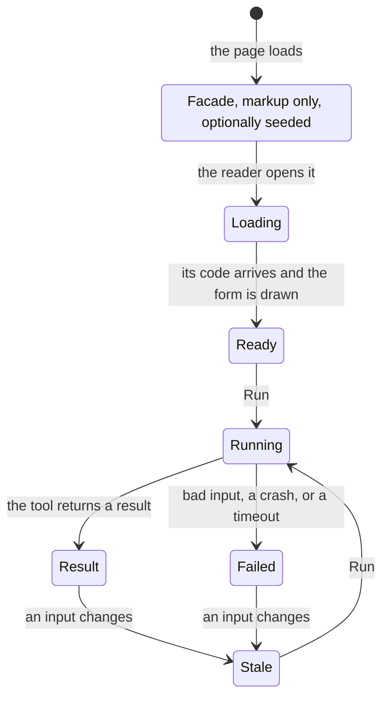

A card costs only its markup until it is opened, and after its first run every edit returns it to stale
until the reader presses Run again.

Compute it with `seed()` rather than writing it by hand. A hand-written seed is correct on the day it is
typed and drifts silently afterwards, showing a confidently wrong answer to every reader who does not
press Run. That is not hypothetical: the seed in this repository's own bench was hardcoded and had drifted
by the time `seed()` replaced it.

```ts
// In your build: a Vite plugin, an Astro integration, a script that writes HTML.
import { seed, serialiseSeed } from "@toolbench/sdk";

const output = await seed({ manifest, tool });
// A card renders only the first part of a group, so there is no point shipping the rest.
const forCard = output.kind === "group" ? output.parts[0] : output;

html = `<tool-host tool="percentiles" mode="card">
  <script type="application/json" data-toolbench-seed>${serialiseSeed(forCard)}</script>
</tool-host>`;
```

⚠️ Use `serialiseSeed`, not `JSON.stringify`. An HTML parser ends a `<script>` at the first `</script` in
its text however the JSON is quoted, so a tool that echoes any part of its input could otherwise truncate
your page. [`bench/vite.config.ts`](bench/vite.config.ts) is a working 30-line version of the above.

`seed()` **throws** if a tool crashes on its own defaults or rejects them, because both are authoring bugs
and a card seeded with an error is worse than an unseeded one. Wrap it if you would rather have a missing
seed than a failed build.

## How a tool runs

The reader decides. Nothing runs on its own.

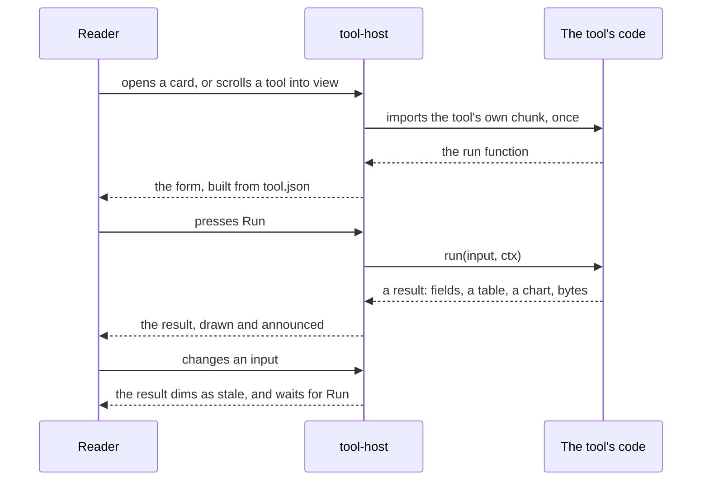

Opening a tool only loads it: the tool runs when the reader presses Run, and an edit marks the last
result stale rather than replacing it.

* Opening a card, or scrolling a tool into view, loads its code and shows the form. It does not run
  the tool.
* **Run** runs it. So does <kbd>Enter</kbd> in a single-line input, or <kbd>Ctrl</kbd>/<kbd>Cmd</kbd> +
  <kbd>Enter</kbd> in a textarea.
* Changing an input marks the current result stale: it dims, and the status line says so. The previous
  result stays on screen because it is still the last true one, and keeping it is what lets you compare
  before and after.
* A tool that is genuinely instant can set `"autoRun": true` and update as the reader types. It is off
  by default, and the validator rejects it for worker-mode tools.

The progress bar appears only if a run is still going after 400 ms. A bar that flashes for 20 ms draws
the eye to report that nothing happened.

**A tool can ship its own examples.** `samples` is a list of labelled inputs, which the runtime draws as
a row of buttons under the form:

```jsonc
"samples": [
  { "label": "Definitions disagree", "input": { "values": "3 4 4 5 6 7 9 14 40 260", "method": "linear" } },
  { "label": "Not a number", "input": { "values": "12, 14, 15, 18ms, 21, 24, 31, 44" } }
]
```

Clicking one fills the form, which is an input change like any other: the result goes stale and waits for
Run, or re-runs if the tool set `autoRun`. Each `input` is partial, so a sample changes the one thing it is
about and leaves the rest as the reader left it. The sample most worth shipping is the one the tool
rejects, because nobody types a broken input by hand, and it is the only way a reader sees the failure path
before meeting it for real. Cards show no samples: there is room there for one input and a Run button.
Added in contract version 3, and
[docs/authoring-a-tool.md](docs/authoring-a-tool.md#4b-sample-inputs) covers choosing them.

**A select can be a preset.** When the right values for several inputs depend on one earlier choice,
give that select's options `sets`, and choosing one fills those inputs for the reader to edit:

```jsonc
{ "id": "stack", "type": "select", "label": "Library", "default": "a", "options": [
  { "value": "a", "label": "Library A", "sets": { "read": 30, "retries": 2 } },
  { "value": "b", "label": "Library B", "sets": { "read": 60, "retries": 3 } },
  { "value": "custom", "label": "Custom" }
] }
```

Choosing an option is a sample at the top of the form: the same write, the same stale result, and the
status line names it. `run` still receives the select's own value. The select then follows the form, so it
never names a preset the values have left: edit a filled field, or click a sample, and it shows the preset
the values match, else the first option with no `sets`, and the status line says it changed. A host writing
the select through `values` is taken literally and fills nothing. `sets` is checked like a sample's
`input`, and may not name its own select or another preset select; the default option's `sets` must equal
those inputs' defaults. Contract version 6.

**A textarea can be highlighted.** Give a `textarea` input a `lang`, and a host that passes `highlight`
to `defineToolHost` paints what the reader types with the same hook `code` results use, so a site keeps
one highlighter:

```jsonc
{ "id": "config", "type": "textarea", "label": "Client config", "lang": "json" }
```

The paint sits behind the real textarea, so the caret, selection, undo, paste and the screen reader are the
browser's own, and it is `aria-hidden`. It catches up 250 ms after typing stops, showing plain text until
then, and stays plain past 20,000 characters. With no hook, a hook that throws, or a hook whose text is not
the source, the textarea is the plain one, unless the tool brings a grammar (below). Its code is a chunk of
its own, about 1.5 KB, fetched only by a tool that declares `lang` on a host with a hook, or with a grammar.
`lang` is refused on any other input type. Contract version 6.

**A tool can bring a grammar for its own notation**, the language no host highlighter knows. Beside
`lang`, a `grammar` lists keywords, a comment prefix, operators and string delimiters, and the runtime
paints the textarea with them the same way, in the same lazily fetched chunk:

```jsonc
{ "id": "machine", "type": "textarea", "label": "Machine", "lang": "doors",
  "grammar": { "keywords": ["state", "on"], "comment": "#", "operators": ["->", ":"], "strings": "\"" } }
```

There are no patterns, so a tool cannot ship a regular expression that freezes the page, and validation
caps every list. A host hook that paints the `lang` still wins. Contract version 7.

**A host can prefill the form** without putting those examples in the tool, and without reaching into
the shadow root. `values` fills inputs the way typing does. It does not run the tool. `run()` is
opt-in:

```ts
const host = document.querySelector("tool-host");
host.values = { packet: "80 e0 12 34 …", view: "all" }; // partial; does not run
host.run();                                            // optional
```

Unspecified inputs keep their current value. Out-of-range numbers are clamped, an invalid `select`
falls back to that input's default, and a string longer than `maxLength` is cut: a host is not more
trustworthy than a reader. An existing result goes stale, the same as typing. This works before the
form has opened, so a card can be prefilled. A shareable `?in=…` deep link is then a host feature,
with no further contract change.

**A page can follow the tool** through two events on `<tool-host>`, so a deep link, analytics or a
Copy button of the page's own does not have to listen for clicks inside the shadow root. Both bubble
and are composed, so a listener on `document` hears every tool on the page:

```ts
host.addEventListener("tool-input", (e) => saveToUrl(e.detail.values));       // after every change
host.addEventListener("tool-run", (e) => track(e.detail.ok, e.detail.error));  // after the result is drawn
```

A third, `tool-reset`, fires when the reader presses Reset (see [Reset](#reset)), and a fourth,
`tool-share`, when the reader presses the share button (below).

**A reader can share a link to the tool with its inputs.** A `page` or `embed` tool has a small link
icon, named "Copy a link to this tool with its inputs". It copies this page's address with the tool's
inputs added as query parameters, each named `<tool id>.<input id>`:

```
https://example.com/latency?percentiles.values=12+14+15&percentiles.method=linear
```

The page's own parameters stay, and any parameter of this tool's already in the address is replaced.
The tool's id in each name is what lets several tools share one address; the same tool twice on one page
reads the same parameters. A tool opening on a page with such parameters starts with those values, and
they count as its starting values, so Reset goes back to them. An input marked `share: false` is never
written or read; a host building its own links gets the same rule from `shareableInputs(manifest)` in
`@toolbench/sdk`, which is the one the button uses. A check mark and "Link copied" show for two seconds and are announced; if the clipboard
refuses, the link is shown, selected, to copy by hand. The element then dispatches `tool-share` with
`{ url, values }`.

| | Attribute | `defineToolHost` option |
|---|---|---|
| Remove the button, and read nothing from the address | `share="none"` | `share: "none"` |
| Text beside the icon | `share-label="Copy link"` | `shareLabel` |
| Where it sits: `top`, the end of the title row, or `actions`, the end of the Run row | `share-position` | `sharePosition` |
| Your own link scheme | | `share: { url(id, values), read(id) }` |

`top` is the default on a page and `actions` in an embed, where a button at the top would sit on the
first input on a phone. A card has no share button, and neither has `controls="none"`, where the page
owns the controls. An attribute overrides the option. A scheme of your own is a pair because a tool opens
with what `read` returns, so a `url` without its `read` would copy links that open on the defaults. The
button is `::part(share)` for styling from outside the shadow root.

`tool-input` fires once per change to the inputs, whatever made it: typing, a sample, a preset or a
`values` write, which dispatches it before the setter returns. A write that leaves the values as they
were fires nothing. `tool-run` fires once per run, from Run, `run()`, `reveal()` or an `autoRun` tool's
typing, after the result or error is on screen and before `run()` resolves; `detail` is `{ values, ok,
error? }`, with the values that run used. A run replaced by a newer one fires nothing. Neither fires
while the tool first opens with its starting values, an `autoRun` tool's first answer included. The
`ToolHostEvents` type names both, for a listener in TypeScript.

**A page can link to one part of a result.** A tool gives a part an `id`, and `reveal(id)` brings it to
the reader: it opens a closed card, shows the part if `parts` or `more` hid it, scrolls to it and moves
focus there. It resolves `false` for an id the result does not have.

```ts
// The tool returns { kind: "group", parts: [..., { kind: "series", id: "trade", chart }] }
document.querySelector("#trade-link").addEventListener("click", () => host.reveal("trade"));
```

## Result shapes

A tool returns one of a closed set of shapes, so the runtime can draw anything a tool produces and a
tool cannot invent something nobody can render.

| Kind | Use for |
|---|---|
| `fields` | Label and value pairs, optionally grouped under headings |
| `table` | Columns and rows, with alignment and per-cell emphasis. A Copy button puts it on the clipboard as tab-separated text, which pastes into a spreadsheet as cells |
| `series` | A chart with axes, legend and annotations. Ships the same numbers as a table for readers who cannot see it |
| `graph` | Nodes and edges the runtime lays out: flowcharts, state machines, dependency graphs, org charts, networks, entity-relationship diagrams. Every edge is also listed in a table, and the picture follows the arrow keys |
| `text` | Prose or preformatted output |
| `code` | Source, with a language tag. The runtime renders preformatted text with a Copy button, which copies the source exactly. A host that already has a highlighter passes `highlight?: (source, lang) => Node` to `defineToolHost` |
| `bytes` | Raw bytes as a reader of a wire format wants them: offsets, hex, a printable gutter, and named ranges that can wrap a row, each in its own series colour with a matching legend entry |
| `group` | Several of the above in one result. A decoder that returns fields *and* a table is the common case |
| `error` | The input was wrong. Naming the input marks that control invalid and attaches the message to it |

Returning `error` means the input was bad and the tool worked. Throwing means the tool has a bug. The
two render differently on purpose.

Any part, and any field, may carry a `role`, a name such as `"verdict"` or `"stats"` that the runtime
renders as `data-role` and gives no meaning, so a [host stylesheet](STYLING.md) can find it by name.

## Worker mode

A tool whose running time depends on its input sets `"thread": "worker"`. That is the only mode where a
timeout can stop a run, because on the main thread there is nothing to terminate.

The host then needs one file, and it has to live in the host project because only the host's bundler
can resolve the host's tools:

```ts
// tool.worker.ts
import { createToolWorker } from "@toolbench/runtime/worker";
import { registry } from "./registry.ts";

createToolWorker({ load: (id) => registry[id].load() });
```

```ts
defineToolHost({
  source,
  workerFactory: () => new Worker(new URL("./tool.worker.ts", import.meta.url), { type: "module" }),
});
```

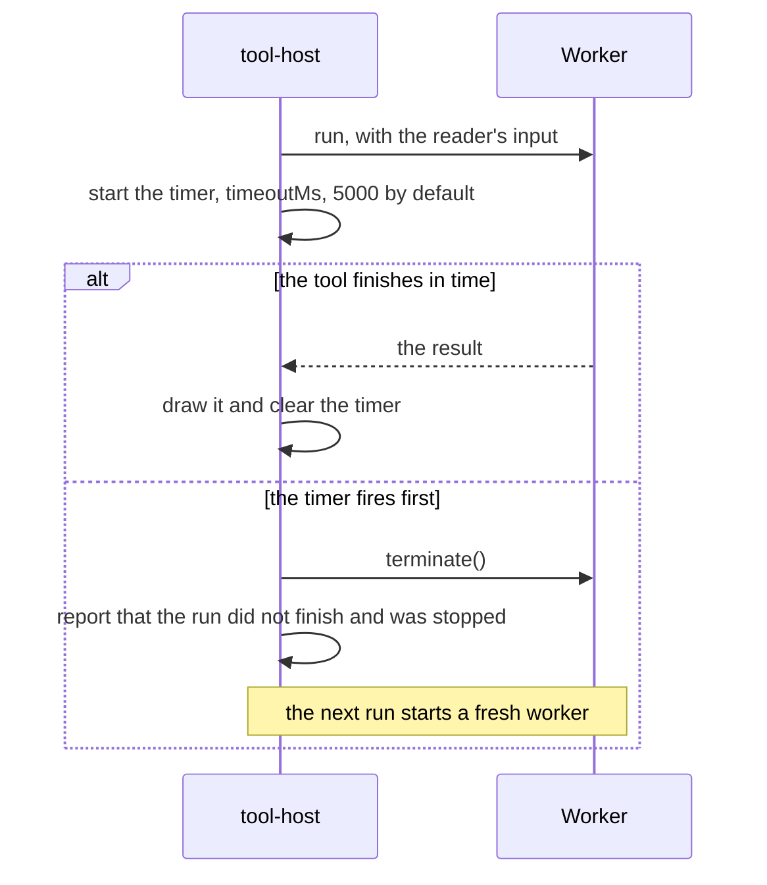

A worker-mode run either returns before its timeout or is terminated, and the page stays responsive in
both cases.

Two things to know before you spend an afternoon on them:

* **Vite defaults `worker.format` to `"iife"`**, which cannot code-split. A worker that imports tools
  builds in development and fails the production build. Set `worker: { format: "es" }`.
* If no `workerFactory` is configured, a worker-mode tool runs on the main thread and logs a warning.
  A slow tool is better than a missing one.

The same factory makes one more worker for the page, the first time a `graph` past a hundred nodes needs
laying out, so a large graph never stops the page: its edge table shows at once and the picture follows.
Without a factory, a large graph is laid out on the main thread after a frame.

## Theming

The runtime renders inside a shadow root. Your CSS cannot reach in and break a tool, and the tool's CSS
cannot leak out and break your page. Theming is therefore a list of custom properties, set from your
page; layout and emphasis are a host stylesheet, below:

```css
tool-host {
  --tb-accent: #0b6b5f;
  --tb-bg: #ffffff;
  --tb-surface: #f4fbf9;
  --tb-border: #b9dbd4;
  --tb-radius: 2px;
  --tb-font: Georgia, serif;
  --tb-mono: "SF Mono", monospace;
}
```

`--tb-accent` is a fill colour. Accent-coloured text (links, the card's hint, annotation labels) reads
`--tb-accent-text`, and text on an accent fill (the Run button's label) reads `--tb-accent-ink`. They
default to the accent and to the surface colour. Set them when the accent is bright, since a bright
amber that works as a button cannot be small text on white, and white text on it is unreadable:

```css
tool-host { --tb-accent: #f59e0b; --tb-accent-text: #a46805; --tb-accent-ink: #000; }
```

The form reads four of its own, `--tb-input-bg`, `--tb-input-border`, `--tb-input-fg` and `--tb-desc-fg`,
which default to the surface, border, text and faint colours. Each input's row carries `data-input` (its
id), `data-type` and, when the tool gave it one, `data-role`, so one input can be recoloured alone:

```css
.tb-field-row[data-role="threshold"] { --tb-input-border: var(--tb-accent); }
```

Defaults use `light-dark()`, so a tool follows the page's colour scheme before anyone configures
anything. The full list is at the top of
[`packages/runtime/src/styles.ts`](packages/runtime/src/styles.ts).

A chart's labels are `--tb-chart-font` (default `0.75rem`) at any width, because a chart is laid out for
its measured width rather than scaled to it, and `--tb-chart-max-width` caps how wide one is drawn. See
[STYLING.md](STYLING.md#chart-text-and-width).

### Host stylesheets

For anything a custom property cannot say, such as a verdict drawn large, stat tiles, bordered tables or
table rows that stack on a phone, pass your own CSS and the runtime adopts it into every tool's shadow
root, after its own:

```ts
defineToolHost({ source, styles: [".tb-out-table td { border: 1px solid var(--tb-border); }"] });
```

`styles` takes a `CSSStyleSheet`, CSS text, a list of either, or `{ "*": [...], "tool-id": [...] }` for one
tool to differ. `setHostStyles(styles)` swaps them on every tool without a reload. The runtime's own rules
are in `@layer toolbench`, so any rule of yours outside a layer wins, whatever its specificity.

The class names and attributes a host sheet may rely on, `data-kind` on every part, `data-role` where a
tool named one, and `data-label` on table cells among them, are versioned API, listed in
[STYLING.md](STYLING.md) with four worked examples.

## Size and cost

Measured on the built bench with gzip, not estimated:

| | Transfer |
|---|---|
| Runtime plus the bench's page wiring, once per page that uses a tool | 28.0 KB |
| Share button, only for pages with a `page` or `embed` tool that draws it | 1.4 KB |
| Worker entry, only for pages with a worker-mode tool | 5.0 KB |
| Graph kind, only for pages that draw a `graph`: layered layout, orthogonal edges, drawing and keyboard | 18.6 KB |
| `percentiles` tool chunk | 1.3 KB |
| `queue-explorer` tool chunk | 1.2 KB |
| `regex-explainer` tool chunk | 2.8 KB |
| `histogram` tool chunk | 0.8 KB |
| `build-order` tool chunk | 1.2 KB |
| A page with no tool on it | 0 bytes |
| A card nobody opens | 0 bytes of tool code |

Reproduce with `pnpm bench:build && node scripts/size-check.mjs`. CI runs the same check against a
budget, so these numbers cannot rot.

## Browser and runtime support

In the browser the runtime needs custom elements, shadow DOM, `IntersectionObserver`, module workers
and CSS container queries: Chrome 105+, Firefox 114+, Safari 16.4+.

CI runs the bench suite against Playwright's Chromium, Firefox and WebKit, on every pull request. That
turns "it works in three engines" from a claim into something checked. Note what it does not establish: those
are the engines Playwright ships today, not the version floors above, so the floors remain the oldest engines
the code is written against rather than the oldest ones tested. Locally, after `pnpm bench:build`:

```sh
pnpm exec playwright install firefox   # or webkit, or chromium
PLAYWRIGHT_BROWSER=firefox pnpm test:bench
```

Unset, `pnpm test:bench` still opens system Chrome (`CHROME_CHANNEL`, default `chrome`). CI sets
`CHROME_CHANNEL=chromium` so the runner uses the browser Playwright just installed.

No runtime gap turned up on those three engines. One test-harness difference did: Playwright's page
request listener reports a worker's module `import()` as `script` on Chromium, `xhr` on WebKit, and
not at all on Firefox. The suite reads the worker's own performance timeline for that allowlist, which
is the observation that holds on every engine.

Two newer features are used with plain fallbacks in front of them, so a browser without either gets
light colours rather than a broken layout: `light-dark()` for automatic dark mode (Chrome 123+,
Firefox 120+, Safari 17.5+) and `color-mix()` for one focus ring. Anything older than the baseline
above shows the static facade and its seeded result, which is one reason seeding is worth doing.

Development and tests: Node 24 or newer. Toolbench runs TypeScript directly, which is how fixtures
execute with no build step. Any bundler for the host site; the examples use Vite 7.

## Non-goals

* **Not a code playground.** Readers do not write code here. That needs a compiler in the browser,
  which is megabytes.
* **Not a notebook.** No dataflow between tools, no execution order.
* **Not a sandbox.** A tool is code you wrote and bundled. Worker mode is a stability boundary that
  lets a slow run be stopped; it is not a security boundary, and the docs never pretend otherwise. Code
  you did not write needs a different design.
* **The contract is pure functions only.** No file input, no network access, at contract version 4.
  Both are planned as additive versions, which is the case the versioning policy exists to handle.

## Repository layout

| Path | What it is |
|---|---|
| `packages/sdk` | The contract: types, manifest validation, version migration, fixture runner. No dependencies, no DOM. |
| `packages/runtime` | `<tool-host>`: the element, the form, the renderers, the runner, the worker protocol. |
| `tools/` | Three example tools (`percentiles`, `queue-explorer`, `utf8-bytes`), with fixtures and help. |
| `bench/` | The test bench, which the browser suite runs against: three display modes, both threading modes, host theming, and a tool that fails on purpose (on its own page). Local only, with `pnpm bench`. |
| `site/` | The project site and its gallery, published to GitHub Pages. |
| `docs/` | Architecture, authoring, versioning. |

```sh
pnpm install
pnpm check          # typecheck, unit tests, every tool's fixtures
pnpm new-tool <id>  # scaffold tools/<id>/ (four files, already green)
pnpm bench          # the bench on http://localhost:5180
pnpm test:bench     # the same bench, in Chromium, Firefox, or WebKit
pnpm coverage       # Node suite coverage: uncovered list, no threshold
# live: https://eknowledger.github.io/toolbench/
```

## Documentation

| Document | For |
|---|---|
| [docs/architecture.md](docs/architecture.md) | How it works, where the boundaries are, how to change it, how to contribute |
| [docs/authoring-a-tool.md](docs/authoring-a-tool.md) | Writing, testing and shipping a tool |
| [docs/versioning.md](docs/versioning.md) | The compatibility policy and how to raise the contract version |
| [STYLING.md](STYLING.md) | Host stylesheets, and the class names and attributes they may rely on |
| [docs/releasing.md](docs/releasing.md) | How versions are decided and how a release reaches npm |
| [CONTRIBUTING.md](CONTRIBUTING.md) | Setup, the loop, and which opinions are load bearing |
| [SECURITY.md](SECURITY.md) | The threat model, and what is in scope to report |
| [ROADMAP.md](ROADMAP.md) | What is planned, in what order, and why that order |

## Licence

[MIT](LICENSE).
