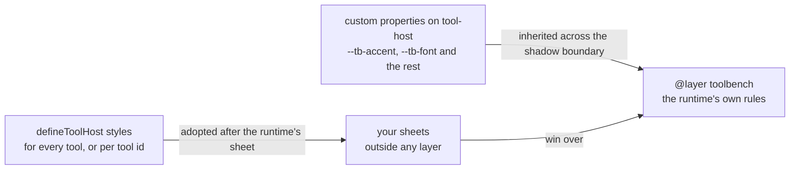

# Styling tool output

A tool's result is drawn inside a shadow root. Your page's CSS cannot reach in, so a host restyles it in
one of two ways:

1. **Custom properties** (`--tb-accent`, `--tb-bg`, `--tb-font` and the rest), set on `tool-host` from
   your page. Colours, fonts, radius, spacing. See [Theming](README.md#theming).
2. **Host stylesheets**, adopted into every tool's shadow root by the runtime. Layout, size, borders,
   emphasis: anything CSS can do to the markup described below.

This document is about the second, and it is versioned API: the class names and attributes listed here
are a contract, under the rule in [What may change](#what-may-change).



Custom properties reach the runtime's rules by inheritance, and your sheets sit in the same shadow root
after them, outside its layer, so they win.

## Passing a stylesheet

```ts
import { defineToolHost, setHostStyles } from "@toolbench/runtime";

defineToolHost({
  source,
  styles: [hostSheet, ".tb-out-table td { border: 1px solid var(--tb-border); }"],
});
```

`styles` takes a `CSSStyleSheet`, a string of CSS, or a list of either. A string is parsed once and the
resulting sheet shared by every tool on the page. To give one tool something extra, pass a map, where
`"*"` applies to every tool and comes first:

```ts
defineToolHost({ source, styles: { "*": [base], "my-tool-id": [extra] } });
```

`setHostStyles(styles)` replaces the host's sheets on every tool already on the page and on every one
created later, without reloading, which is what a theme switch needs. `setHostStyles(undefined)` removes
them.

A sheet your page adopted into a shadow root by hand is left where it is, after the runtime's own.

### The guarantee: your rules win

**Every rule the runtime ships is inside `@layer toolbench`.** A rule in your sheet that is not inside a
layer beats every runtime rule, whatever the specificity of either. You do not need to match the
runtime's selectors, or read them, to override them.

So `.tb-out-table td { text-align: start }` wins over the runtime's more specific
`.tb-out-table td[data-align="end"] { text-align: end }`. Without the layer it lost, and stacked table rows
kept half their values pinned to the right edge.

If you put your own rules in a layer, they are compared with `toolbench` by layer order instead, which is
standard CSS: a layer declared later wins.

The runtime's sheet is always first in the root, and yours after it, whichever was adopted first.

Where `adoptedStyleSheets` is unavailable, the runtime's sheet and yours become `<style>` elements in the
same order, so the cascade is the same.

## What you can select

### Structure

| Class | Element |
|---|---|
| `.tb` | The frame around everything a tool draws. A size container, so `@container` queries measure the tool, not the viewport |
| `.tb-head`, `.tb-title`, `.tb-name`, `.tb-blurb`, `.tb-mark` | The heading, the tool's name, its one-line blurb, and a `deprecated` or `retired` mark |
| `.tb-body` | Form, actions, status and output |
| `.tb-facade`, `.tb-facade-hint` | A closed card, and its "Try it" control |
| `.tb-form`, `.tb-field-row`, `.tb-label`, `.tb-desc`, `.tb-input`, `.tb-textarea`, `.tb-select`, `.tb-checkbox`, `.tb-slider` | The generated form |
| `.tb-samples`, `.tb-sample` | The row of sample inputs, and each button |
| `.tb-share-bar`, `.tb-share`, `.tb-share-note`, `.tb-share-top` | The share button (#227), the note beside it, and the row that puts it at the end of the title. The button carries `data-copied` while it shows the check mark, and is also `::part(share)` |
| `.tb-actions`, `.tb-run`, `.tb-reset`, `.tb-progress` | The Run button, the Reset button beside it (carries `hidden` while the inputs are at their starting values), and the progress bar |
| `.tb-status` | The visible status line |
| `.tb-output` | Where the result is drawn |
| `.tb-more`, `.tb-disclose`, `.tb-rest` | A truncated result's notice, its expand button, and the parts it reveals |
| `.tb-copy-bar`, `.tb-copy`, `.tb-copy-note` | Under a code or table result: the row, its Copy button, and the note beside it saying whether the copy worked. Not on a closed card |
| `.tb-foot` | Links under the tool. Absent with `links="none"`, and holds only "Open the full tool" with `links="page"` |

### Result parts

Every part of a result has `data-kind` on its root element, naming its kind: `fields`, `text`, `code`,
`table`, `series`, `heatmap`, `pie`, `radar`, `treemap`, `venn`, `graph`, `bytes`, `group` or `error`. A part
the tool gave a `role` also has `data-role`, with the tool's string unchanged.

| Kind | Root | Inside it |
|---|---|---|
| `group` | `.tb-group` | One root per part |
| `fields` | `.tb-out-fields` | `.tb-fields` (a `<dl>`, for grouped and ungrouped fields alike), `.tb-field-group` with an `<h4>` for a group, `.tb-field` (with `<dt>` and `<dd>`), `.tb-value`, `.tb-note`. The `<dd>` carries `.tb-mono` unless the field says `mono: false` |
| `table` | `.tb-out-table` | A `<table>`, with `<caption>`, `<thead>`, `<tbody>`, then `.tb-copy-bar`. A cell carries `.tb-mono` when it or its column says `mono`, and a header when its column does. A `rowHeader` column's cells are `<th scope="row">` with a cell's attributes, and its heading carries `data-row-header` |
| `text` | `.tb-out-text` | A `<p>`, or a `<pre class="tb-mono">` |
| `code` | `.tb-out-code` | `<pre><code class="language-…">`, then `.tb-copy-bar` |
| `bytes` | `.tb-out-bytes` | `.tb-bytes-grid`, `.tb-bytes-row`, `.tb-bytes-offset`, `.tb-bytes-hex`, `.tb-bytes-ascii`, `.tb-byte`, `.tb-bytes-legend`, `.tb-bytes-caption` |
| every chart kind | `.tb-out-chart`, plus `.tb-out-chart-card` on a card | The chart's own markup. Not covered: see below |
| `graph` | `.tb-out-graph` | `.tb-graph-plot` (the picture, one tab stop), `.tb-graph-readout`, `.tb-graph-data` (the edge table, a `<details>`), `.tb-graph-message` (why a graph is listed instead of drawn, or that it is being laid out). Inside the picture, the parts below |
| `error` | `.tb-out-error` | `.tb-error-message` |

A chart's internal markup, the SVG and its classes, is not part of this contract. Style a chart through its
root and the series colour properties. Its insides are drawn geometry and will change.

### Chart text and width

A chart is laid out for the width it is given, one SVG unit to one CSS pixel, and laid out again when that
width changes. Its labels are therefore the size you set at any width, and nothing in it is stretched. Two
properties size it, set on `tool-host` or anything around it:

| Property | Default | What it does |
|---|---|---|
| `--tb-chart-font` | `0.75rem` | The size of every label inside a chart. The margins are measured from the labels, so a larger size makes room for itself rather than overlapping |
| `--tb-chart-max-width` | `100%` | The widest a chart is drawn. Wider than this, the chart keeps this width at the start of its row |

```css
/* Larger chart labels, and no chart wider than a reading column. */
tool-host { --tb-chart-font: 0.875rem; --tb-chart-max-width: 48rem; }
```

Below 480px a chart takes a narrow layout: fewer gridlines, each horizontal bar's name on its own line above
its bars, a pie's key under the pie, and a Venn diagram's set names in a key under the picture.

⚠️ A chart's first drawing, made before it is on the page, is at a guessed width of 640 pixels. It is
replaced by one at the measured width, usually before anything is painted, so a script that keeps a reference
to the figure returned by `render` holds the replaced one. Find it again by `data-kind` or `data-part`
instead. A script that points at a chart or measures one should wait for `data-fitted` on the figure: it
marks the drawing at the measured width, the one that stays. Counting frames is not enough on a busy machine.

### Inside a graph

A graph's picture is different: a tool names its nodes, edges, groups and lanes, so a host can style them
by name. Every one carries `data-kind`, and `data-role` when the tool gave it one. Where they are drawn is
geometry and not covered; what they are, below, is.

| `data-kind` | Element | Also carries |
|---|---|---|
| `node` | `.tb-graph-node`, a `<g>` with `.tb-graph-shape` (the outline), `.tb-graph-name` and `.tb-graph-note` | `data-id`, `data-shape`, `data-color` |
| `collapsed-group` | `.tb-graph-node` standing for a closed group's members | `data-id` (the group's), `data-color` |
| `edge` | `.tb-graph-edge`, a `<g>` with `.tb-graph-line`, `.tb-graph-mark` for each end and `.tb-graph-label` | `data-line` (`dashed`, `dotted`), `data-width` (`thin`, `thick`), `data-color`, `data-routed` |
| `group` | `.tb-graph-group`, the rectangle | `data-id`, `data-depth`, `data-color` |
| `group-title` | The group's title, which closes it | `data-id` |
| `lane` | `.tb-graph-lane`, the band | `data-id` |
| `badge` | `.tb-graph-badge` | |

`data-color` is the tool's `tone` or `color`, `bad` or `series-3` say, and every coloured rule reads one
custom property, `--c`, so a host recolours a category by its `data-color` alone. A mark carries
`data-end` (`head`, `tail`) and `data-fill` (`solid`, `hollow`, `none`). A node or edge on the highlighted
path carries the class `tb-path`, and while a reader points at or focuses a node, it and its edges carry
`tb-hot` and its neighbours `tb-near`. A row of the edge table for a node with no edges carries
`data-orphan`.

A graph scaled to fit carries a button above its drawing, `.tb-graph-wide` in a `.tb-graph-bar`, with
`aria-pressed="true"` while the graph is at full size (#198). It also carries `part="wide-toggle"`, so the
page's own stylesheet can reach it from outside the shadow root, where a `styles` sheet would use the class:

```css
/* In the page's stylesheet, not in `styles`: ::part is how a page reaches into the shadow root. */
tool-host::part(wide-toggle) { border-radius: 999px; color: var(--tb-accent-text); }
tool-host::part(wide-toggle):hover { border-color: var(--tb-accent); }
```

The share button (#227) is `part="share"` the same way, so a page can restyle it without a
`styles` sheet:

```css
tool-host::part(share) { border-radius: 999px; }
tool-host::part(share):hover { border-color: var(--tb-accent); }
```

```css
/* Decisions in a flowchart, drawn heavier: the tool set role: "decision" on them. */
.tb-graph-node[data-role="decision"] > .tb-graph-shape { stroke-width: 2.5; }
/* Development-only dependencies, faded. */
.tb-graph-edge[data-role="dev"] { opacity: 0.5; }
```

### Attributes

| Attribute | On | Values |
|---|---|---|
| `data-kind` | Every part's root | The part's kind |
| `data-role` | A part's root, a `.tb-field`, or a `.tb-field-row` | Whatever `role` the tool set on the part, field or input. Absent when it set none |
| `data-input` | `.tb-field-row` | The input's `id` |
| `data-type` | `.tb-field-row` | The input's `type`: `text`, `textarea`, `number`, `select`, `toggle` |
| `data-part` | A part's root | Whatever `id` the tool set, unique in the result. Absent when it set none. `host.reveal(id)` goes to it |
| `data-label` | Every table cell | Its column's label. Absent for a column with an empty label |
| `data-tone` | `.tb-field`, table cells | `normal`, `good`, `warn`, `bad`, `muted` |
| `data-align` | Table cells and headers | `start`, `end` |
| `data-row-header` | The heading of a `rowHeader` column | Present or absent (contract version 8) |
| `data-wrap` | Table cells and headers | `prose`, `none`: the column's or the cell's `wrap` (contract version 8). Absent when neither says |
| `data-series` | `.tb-byte`, `.tb-bytes-legend li` | `1` to `6`: the series colour of a range with no tone, in order, round again after six. Absent on a toned range |
| `data-lang` | `.tb-out-code` | The code's language |
| `data-tok` | A token a tool's `grammar` painted in a textarea, inside `.tb-paint` | `keyword`, `string`, `comment`, `operator`. Colour only: a rule that changes a token's width moves the caret off the glyph |
| `data-state` | `.tb-output` | `running`, `idle` |
| `data-stale` | `.tb-output` | Present when the inputs have changed since the result was drawn |
| `data-status` | `tool-host` itself | `deprecated`, `retired`. Absent for a live tool |
| `data-fitted` | `.tb-out-chart` | Present once the chart is laid out at its measured width and nothing is left to change. Absent on the first drawing, and on a new drawing after a resize until it is measured. See [Chart text and width](#chart-text-and-width) |

`role` is the tool's to set: `{ kind: "fields", role: "stats", fields }` names a part, and
`{ label, value, role: "verdict" }` names one field. The runtime attaches no meaning to it, so a host
that styles nothing sees no difference.

The form is named the same way (contract version 8 for `role`): each `.tb-field-row` carries `data-input`
and `data-type`, and `data-role` when the input has a `role`. Its controls read `--tb-input-bg`,
`--tb-input-border` and `--tb-input-fg`, and its description `--tb-desc-fg`, so a host can recolour one
input by setting a property on its row rather than restating the runtime's rules:

```css
.tb-field-row[data-role="threshold"] { --tb-input-border: var(--tb-accent); }
.tb-field-row[data-input="values"] { --tb-desc-fg: var(--tb-muted); }
```

`.tb-mono` is the one class for "this value is a token", on a field's `<dd>` and on a table cell alike, so
one rule reaches both: `.tb-mono { font-family: var(--tb-mono); }` is the runtime's, and a host that wants
its tokens in another face changes `--tb-mono` or writes its own `.tb-mono` rule. A field is mono unless
it says `mono: false` (contract version 8); a table cell is mono only when it or its column says so.

## Examples

All four are plain CSS in a host sheet, and the
[styling page](bench/styling.html) applies them to real results in the browser tests.

**A prominent, colour-coded verdict.** One field, named by the tool with `role: "verdict"`:

```css
.tb-field[data-role="verdict"] { display: block; padding: 0.75rem 1rem; border-radius: var(--tb-radius); border: 1px solid var(--tb-border); }
.tb-field[data-role="verdict"][data-tone="bad"]  { background: color-mix(in oklab, var(--tb-bad) 12%, transparent);  border-color: var(--tb-bad); }
.tb-field[data-role="verdict"][data-tone="good"] { background: color-mix(in oklab, var(--tb-good) 12%, transparent); border-color: var(--tb-good); }
.tb-field[data-role="verdict"] dt { font-size: 0.75rem; text-transform: uppercase; letter-spacing: 0.04em; }
.tb-field[data-role="verdict"] .tb-value { font-family: var(--tb-font); font-size: 1.35rem; font-weight: 650; }
```

**Stat tiles.** A part named `role: "stats"`. `grid-template-columns: 1fr` on the tile is needed: the
runtime lays a field out as label and value side by side, and a tile that keeps that puts both in a 9rem
box and wraps the note a letter at a time.

```css
[data-role="stats"] .tb-fields { display: grid; grid-template-columns: repeat(auto-fit, minmax(9rem, 1fr)); gap: 0.5rem; }
[data-role="stats"] .tb-field { grid-template-columns: 1fr; gap: 0.25rem; padding: 0.75rem; border: 1px solid var(--tb-border); border-radius: 8px; background: var(--tb-surface); }
[data-role="stats"] .tb-value { font-size: 1.5rem; font-family: var(--tb-font); font-weight: 650; }
[data-role="stats"] .tb-note { display: block; margin: 0; }
```

**Bordered tables.** The good and muted tones are coloured by the runtime's own sheet.

```css
.tb-out-table table { border: 1px solid var(--tb-border); }
.tb-out-table th, .tb-out-table td { border: 1px solid var(--tb-border); }
```

**Stacked rows on a narrow tool.** `.tb` is the query container, so this follows the tool's width, not
the screen's:

```css
@container (max-width: 30rem) {
  .tb-out-table thead { display: none; }
  .tb-out-table tr { display: grid; padding: 0.5rem 0; border-bottom: 1px solid var(--tb-border); }
  .tb-out-table td { border: 0; text-align: start; }
  .tb-out-table td[data-label]::before { content: attr(data-label); display: block; font-size: 0.72rem; color: var(--tb-muted); font-family: var(--tb-font); }
}
```

A table with a `rowHeader` column has `th` cells in its body, so write `:is(td, th[scope="row"])` where this
says `td`.

**The built-in narrow layout.** A table whose columns say `wrap` (contract version 8) already has one, in
the runtime's layer, under `@container (max-width: 34rem)`: the table keeps its own width and scrolls
inside its part, headings and `none` cells stay on one line, a `prose` cell is 26ch wide and at least 20ch,
and a `rowHeader` column, with its heading, stays in view while the rest scrolls, as does the caption, wrapping to the part's width. A table that says
nothing about wrapping keeps the layout it had. Wherever a table scrolls, a shadow at an edge says there is
more that way; it is painted over `--tb-scroll-bg`, set on `.tb-out-table` to the frame's colour, which a
host that recolours the frame of an embedded tool sets to match. Any of it can be overridden like any
other runtime rule.

## What may change

Under semver, against `@toolbench/runtime`:

- **Removing or renaming** a class or attribute listed here, changing what it is on, or removing one of its
  values, is a **major** change.
- **Adding** a class, an attribute, or a value is a **minor** change. A host sheet written against one minor
  version keeps working on the next.
- Moving the runtime's rules out of `@layer toolbench` is a major change: it is what makes your rules win.
- Anything **not** listed here, including element nesting beyond what the tables say, chart internals, a
  graph's coordinates, and the runtime's own rule values, may change in any release. Do not select by position
  (`.tb-output > :nth-child(2)`); ask the tool for a `role` instead.
