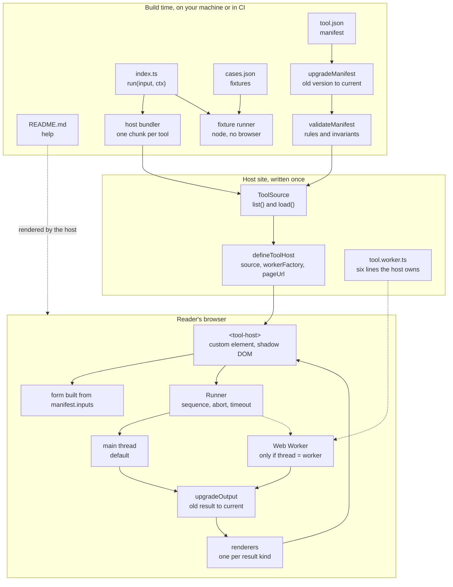
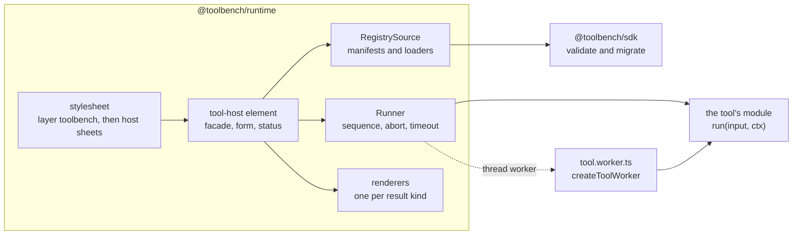
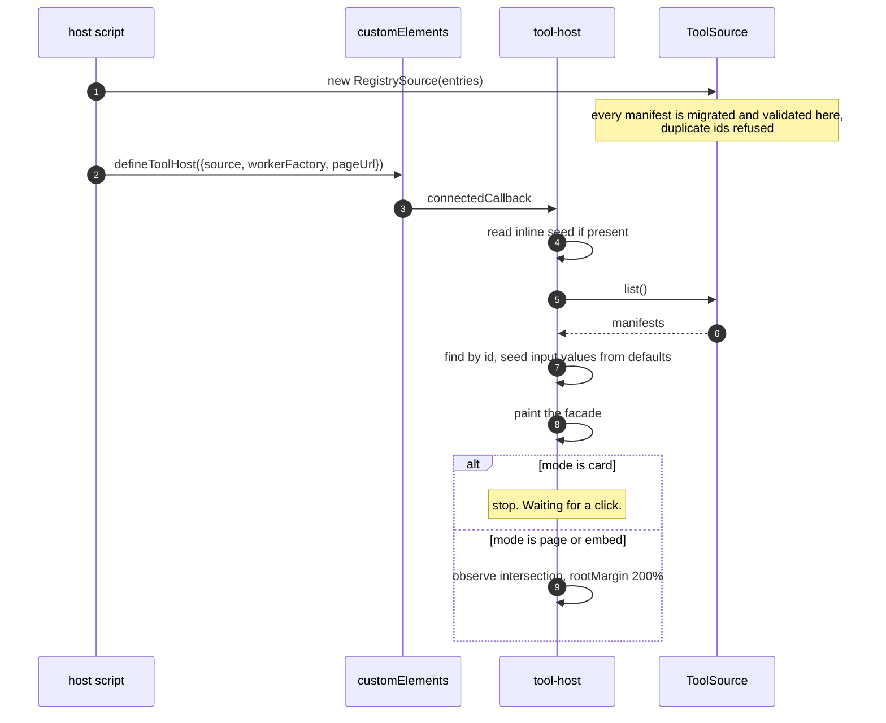
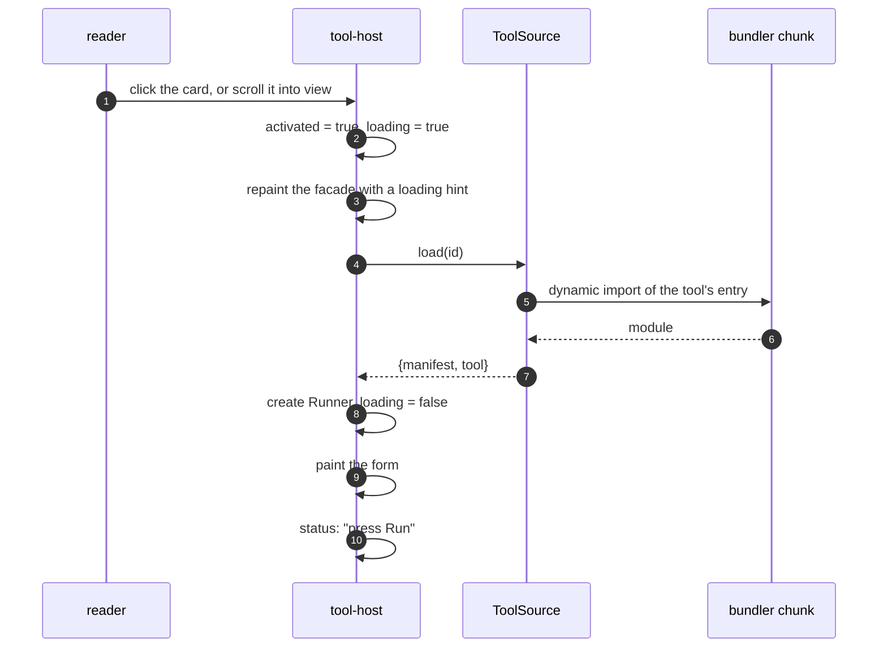
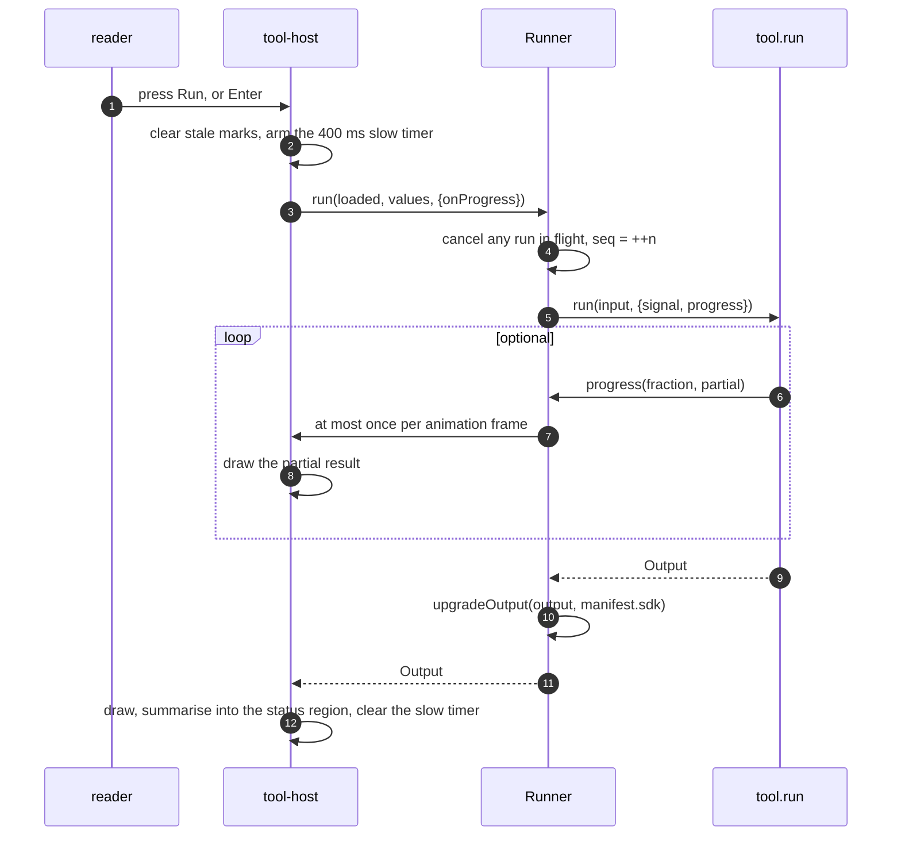
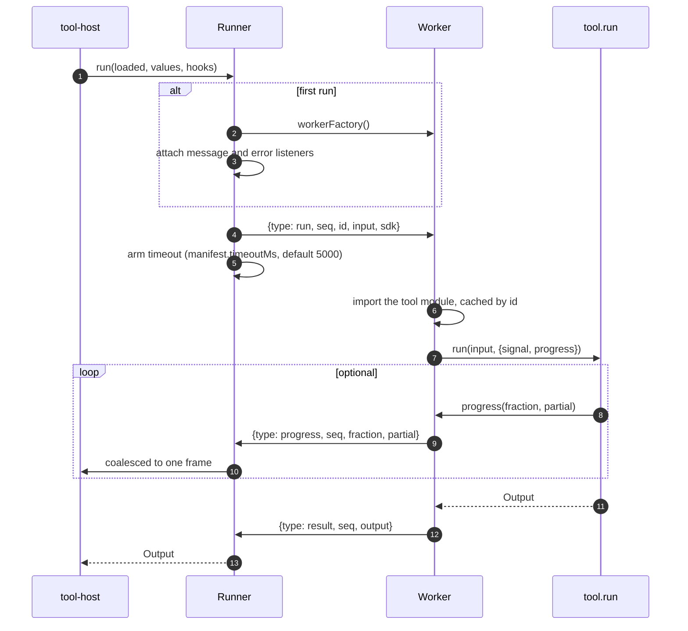
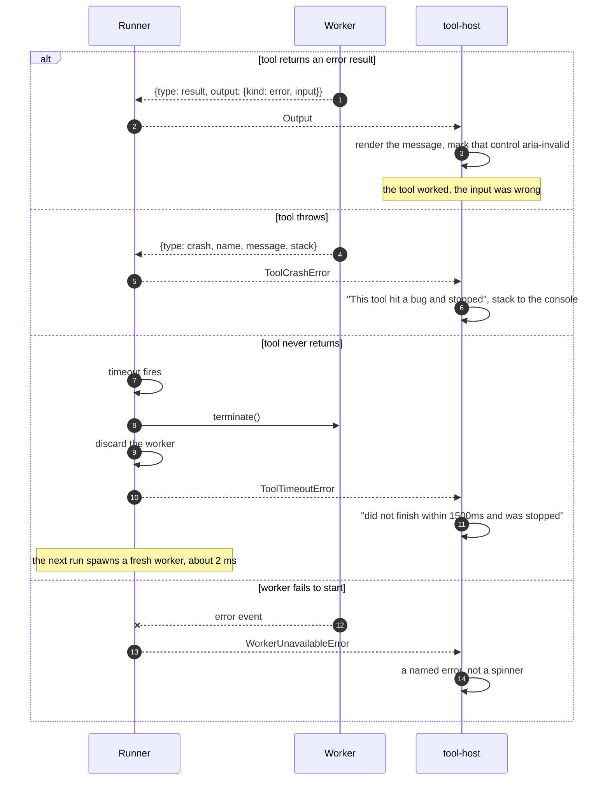
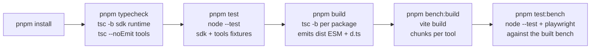

# Architecture

How Toolbench is put together, why the boundaries sit where they do, and what you need to know to
change it.

**Audience.** Anyone working on the packages, reviewing a change, or deciding whether to adopt this.
It assumes you can read TypeScript. It does not assume you have written a custom element, used a Web
Worker, or thought about bundler chunking before; §2 covers the vocabulary.

**Contents**

1. [Scope](#1-scope)
2. [Terminology](#2-terminology)
3. [System overview](#3-system-overview)
4. [Repository layout](#4-repository-layout)
5. [The contract](#5-the-contract)
6. [Components](#6-components)
7. [Control flow](#7-control-flow)
8. [Invariants, and where they are enforced](#8-invariants-and-where-they-are-enforced)
9. [Lifecycle and teardown](#9-lifecycle-and-teardown)
10. [How to change it](#10-how-to-change-it)
11. [Build pipeline](#11-build-pipeline)
12. [Testing strategy](#12-testing-strategy)
13. [Performance budget](#13-performance-budget)
14. [Defect register](#14-defect-register)
15. [Limitations](#15-limitations)
16. [Contributing](#16-contributing)
17. [Appendix](#17-appendix)

---

## 1. Scope

Toolbench does three things:

1. Defines what a **tool** is: a function from named inputs to one of a fixed set of result shapes,
   plus a JSON manifest describing both.
2. Renders a tool in a web page, in one of three presentations, and runs it.
3. Keeps old tools working as the contract grows.

Everything else is out of scope on purpose. There is no editor, no sandbox, no server, no plugin
marketplace, and no dataflow between tools. §15 lists what that costs.

## 2. Terminology

Skip this if the words are familiar.

| Term | What it means here |
|---|---|
| **Tool** | A directory containing `tool.json`, an entry module exporting `{ run }`, fixtures, and help text. |
| **Manifest** | `tool.json`. Identity, inputs, which result shapes the tool can return, and how it should be run. |
| **Contract version** | The integer in `manifest.sdk`. Says which shapes and fields the tool is allowed to use. Not the same as the tool's own `version`, and not the same as the npm package version. |
| **Host** | The website embedding Toolbench. It owns the page, the bundler, and the list of tools. |
| **Custom element** | A browser feature for defining your own HTML tag with behaviour attached. `<tool-host>` is one. Any page can use it; no framework is involved. |
| **Shadow DOM** | A subtree attached to an element whose styles are isolated in both directions: the page's CSS does not apply inside, and the inside CSS does not leak out. The runtime renders into one. |
| **CSS custom property** | A variable like `--tb-accent`. Unlike normal styles, these *do* cross the shadow boundary, which is why theming works by setting them. |
| **Web Worker** | A separate JavaScript thread. It has no DOM access, communicates by message passing, and can be terminated from the outside. That last property is the only reason Toolbench uses one. |
| **Code splitting** | A bundler emitting several JavaScript files instead of one, so a page can download only the parts it uses. Each file is a **chunk**. |
| **Dynamic import** | `import("./x.ts")` as an expression. Returns a promise, and tells the bundler "this is a chunk boundary". |
| **Facade** | A cheap stand-in for something expensive, replaced on demand. A Toolbench card is markup with no behaviour until the reader opens it. |
| **Seed** | A precomputed result embedded in the page, so a card shows something real before any script runs. |
| **Fixture / case** | An entry in `cases.json`: an input and the exact result expected from it. |
| **Type stripping** | Node running a `.ts` file by deleting the type annotations, with no compiler step. Requires that the file contains no syntax that emits code (see §11). |

## 3. System overview

Three phases, and the boundary between them is the thing to hold onto: **the manifest is data and can
move at any time; the tool's code must be present at build time.**



The diagram shows the three phases, build, host and browser, and what crosses between them.

Reading the diagram:

* A **manifest** is validated and migrated before anything sees it, so every component downstream
  deals with current, well-formed data only.
* A **tool's module** reaches the browser through the host's bundler. Nothing fetches code at runtime,
  because doing that on a static site requires `eval`, which costs bundling, tree shaking, and any
  Content-Security-Policy worth having.
* The **worker is optional and per tool.** The runner's interface is identical either way.
* **Results are migrated on the way out**, so a tool written against an older contract renders through
  today's renderers without knowing.

## 4. Repository layout

```
toolbench/
├── packages/
│   ├── sdk/                        @toolbench/sdk   no dependencies, no DOM
│   │   └── src/
│   │       ├── types.ts            the contract: Output, InputSpec, Manifest, Ctx, Tool
│   │       ├── validate.ts         manifest validation and the cross-field invariants
│   │       ├── migrate.ts          version migration chain
│   │       ├── seed.ts             build-time seeding, and safe serialisation for a script tag
│   │       ├── fixtures.ts         the tool-directory walk. Node-only, exported at ./fixtures
│   │       ├── testing.ts          fixture runner and result comparison
│   │       ├── graph.ts            graphProblem, the graph kind's structural rules
│   │       ├── version.ts          SDK_VERSION, supported versions, changelog
│   │       ├── features.ts         the version each key and output field arrived in, and the check against `sdk`
│   │       └── index.ts            public surface
│   └── runtime/                    @toolbench/runtime   no dependencies, no framework
│       ├── test/graph/             the graph families, seeded graphs and geometric checks the tests use
│       └── src/
│           ├── element.ts          <tool-host>: modes, form, states, accessibility
│           ├── runner.ts           execution: sequencing, abort, timeout, progress
│           ├── worker.ts           createToolWorker, the worker side of the protocol
│           ├── protocol.ts         message types and error classes
│           ├── sources.ts          ToolSource interface, RegistrySource
│           ├── styles.ts           the shadow stylesheet and the theming surface
│           ├── dom.ts              three element helpers, so no framework is needed
│           ├── render/index.ts     renderer dispatch, fields, table, text, code, error, group
│           ├── render/chart.ts     the series renderer, SVG plus a data table
│           ├── graph/              the graph kind: layout, routing, drawing, and its chunks
│           ├── register.ts         side-effecting entry for pages without a bundler
│           └── index.ts            public surface
├── tools/
│   ├── cases.test.ts               runs every tool's manifest and fixtures
│   ├── tsconfig.json               tools compile with no DOM and no path aliases
│   ├── percentiles/                pure, main thread, group of fields and table
│   ├── queue-explorer/             pure, worker, group of series and fields, plus convergence tests
│   ├── utf8-bytes/                 pure, main thread, group of fields and bytes
│   ├── regex-explainer/            pure, worker with a 2 s timeout, text and code
│   ├── histogram/                  pure, main thread, bare series, bar shape, no primary input
│   └── build-order/                pure, main thread, group of fields and a graph
├── bench/
│   ├── index.html                  card mode, theming, lifecycle status
│   ├── failure.html                the failing tool, off the landing page
│   ├── tool.html                   page mode
│   ├── article.html                embed mode, two tools in prose
│   ├── graphs.html                 the eleven graph families, one figure each
│   ├── failure.html                stress fixture, kept off the front page
│   ├── bench.test.ts               the runtime driven by Chrome against the built bench
│   ├── fixtures/stress/            a tool that misbehaves on purpose
│   ├── fixtures/retired/           a tool that must not run
│   ├── fixtures/deprecated/        a tool that still runs, marked
│   └── src/                        registry, boot, worker entry, page scripts
├── scripts/
│   ├── new-tool.mjs                scaffolds the four files under tools/<id>
│   └── size-check.mjs              transfer budgets for the built bench
├── docs/                           this file, authoring, versioning
└── .github/workflows/             tests.yml, build.yml, pages.yml, release.yml
```

## 5. The contract

`packages/sdk/src/types.ts` is the whole agreement between a tool author and a host. It is worth
reading in full; this is the shape of it.

### 5.1 A tool

```ts
export interface Tool<I extends InputValues = InputValues> {
  run(input: I, ctx: Ctx): Output | Promise<Output>;
}

export interface Ctx {
  signal: AbortSignal;
  progress(fraction: number, partial?: Output): void;
}
```

Three rules follow, and they are not stylistic:

1. **`run` must not touch the DOM.** It has to work in Node (fixtures), in a worker (no DOM exists),
   and during a host's build (seeding). Any one of those would force it.
2. **`run` must be a function of its inputs.** No clock, no unseeded randomness, no I/O. That is what
   makes a fixture meaningful.
3. **A loop whose length depends on an input must check `ctx.signal`**, and the tool should declare
   `thread: "worker"` so a timeout can stop it.

### 5.2 Results

```ts
export type Output = (
  | { kind: "fields";   fields: Field[] }
  | { kind: "text";     text: string; mono?: boolean }
  | { kind: "code";     lang: string; source: string }
  | { kind: "table";    columns: Column[]; rows: Cell[][]; caption?: string; link?: { chart: string; keys: (number | string | null)[] } }
  | { kind: "series";   chart: Chart }
  | { kind: "heatmap";  heatmap: Heatmap }
  | { kind: "pie";      pie: Pie }
  | { kind: "graph";    graph: Graph }          // contract v7: nodes and edges the runtime lays out
  | { kind: "group";    parts: Output[] }
  | { kind: "bytes";    bytes: number[]; offset?: number; highlight?: ByteRange[]; caption?: string }
  | { kind: "error";    message: string; input?: string; at?: number; len?: number }
  ) & { role?: string; id?: string };   // any part may be named, contract v5
```

The union is closed. A tool cannot invent a shape nobody can draw, and the runtime can promise to draw
anything a tool returns. Two members carry more weight than the rest:

* **`group`** is how one tool answers in several shapes. A decoder returning header fields *and* a
  table of records is the normal case, not an exception. Without it, tools would either lose half their
  output or the contract would need a second result channel.
* **`error`** means the input was wrong and the tool behaved correctly. `input` names the offending
  control, which is what lets a generated form mark it invalid and point a screen reader at the
  message. Without that field, an error can only float unattached. A tool with a genuine bug should
  **throw** instead; §7.5 shows how the two render differently.

### 5.3 Inputs

```ts
export type InputSpec =
  | (InputBase & { type: "text";     default: string; maxLength?: number })
  | (InputBase & { type: "textarea"; default: string; rows?: number; maxLength?: number; lang?: string })
  | (InputBase & { type: "number";   default: number; min: number; max: number; step?: number })
  | (InputBase & { type: "select";   default: string; options: SelectOption[] })
  | (InputBase & { type: "toggle";   default: boolean });

interface InputBase {
  id: string;
  label: string;
  description?: string;   // becomes aria-describedby, not a placeholder
  unit?: string;          // "ms", "req/s". A number without one is a riddle
  primary?: boolean;      // show this input on a compact card; mark as many as the question needs
  dir?: "ltr" | "auto";   // bytes and code stay left to right inside right-to-left prose
}

interface SelectOption {
  value: string;
  label: string;
  sets?: InputValues;     // a preset: choosing this option fills those inputs (contract v6)
}
```

A preset is derived state, not remembered state. After any write (typing, a sample, a host `values`), a
preset select shows the option whose `sets` the form matches, else the first option with no `sets`, else it
stays put. Remembering the choice and switching to "Custom" on a keystroke was mocked up first, and a sample
walked straight past it: it filled a read timeout of 120 while the select still said "Library A", whose
read timeout is 30. A select the write names is taken literally, which is how a host prefills one without
expanding it.

`min` and `max` are required on a number input rather than optional. They are the only thing standing
between a bounded computation and an unbounded one, and the element clamps to them before the tool
sees the value.

### 5.4 The manifest

The fields, and who reads each one:

| Field | Read by | Notes |
|---|---|---|
| `sdk` | migrate, validate | Contract version. Refused if newer than the runtime. |
| `id` | source, element, host routing | Lowercase, hyphenated. Must equal the directory name. |
| `name`, `blurb` | element, host head tags | `blurb` is capped at 200 characters so it works as a meta description. |
| `version` | humans | The tool's own version. Nothing branches on it. |
| `capabilities` | validate, element | `["pure"]` is the only value so far. |
| `runtime.entry` | host bundler, fixture runner | Path relative to the tool directory. |
| `runtime.thread` | runner | `"main"` (default) or `"worker"`. |
| `inputs` | element (form), fixture runner (defaults) | |
| `samples` | validate, element (the row under the form), fixture runner | Labelled example inputs, each `input` partial. Never drawn on a card. |
| `inputs[].lang` | validate, element (the painted textarea) | A textarea's language, passed to the host's `highlight` hook, which paints it behind the textarea. Textarea only. Contract version 6. |
| `inputs[].options[].sets` | validate, element (the select) | A preset: the values choosing that option writes into other inputs. The select then follows the form. Contract version 6. |
| `kinds` | validate, fixture runner, host | Every kind `run` can return. Must include `"error"`. |
| `card` | element, validate | `"live"`, `"info"`, `"none"`. Refused when `status` is not `"live"`. |
| `cardFields` | renderers | How many fields a compact result shows. |
| `autoRun` | element | Run as the reader types. Off by default. |
| `timeoutMs` | runner | Worker mode only. Rejected on the main thread. |
| `help`, `tags` | host | Presentation. |
| `links` | element, host | Specs, source, and the replacement for a retired tool. |
| `status` | element, host | `live` (default), `deprecated`, `retired`. The element honours it. |

## 6. Components

### 6.1 `@toolbench/sdk`

No dependencies, no DOM, no framework. Four modules that matter.

**`types.ts`** is documentation as much as code; §5 is a summary of it.

**`validate.ts`** turns unknown JSON into a `Manifest` or throws a `ManifestError` naming the field.
Hand written rather than schema-library driven, for one reason: the error messages are the interface a
first-time tool author meets. Compare what a generic validator says with what this says:

```
inputs[0].options: a select needs at least two options; with one, use a fixed value

timeoutMs: is only meaningful with runtime.thread = "worker". On the main thread there
           is nothing to terminate, so a timeout here would be a field that lies.
           Either move the tool to a worker or bound its input.
```

The cross-field invariants at the bottom of the file are the interesting part; §8 lists them.

**`migrate.ts`** holds the migration chain: two steps today, `1 → 2` and `2 → 3`, with every half the
identity function. The machinery was built before anything needed it, and tested with synthetic versions,
which is why the first real entry was a five-line change rather than a design exercise under pressure. It
repaid that twice over: while still synthetic, the tests caught a bug where the chain silently did
nothing, because a helper used the module constant instead of the injected current version.

**`testing.ts`** runs fixtures and compares results. Comparison is exact by default. Subset matching is
opt-in and has to justify itself:

| Rule | Why |
|---|---|
| Exact deep equality by default | Catches a field emitted twice, fields reordered, a field dropped, or garbage returned beside a correct error |
| `match: "subset"` requires `why` | An opt-out of exactness should say what it is for |
| Subset on `fields` requires `fieldCount` | Otherwise a dropped field passes |
| Subset descends into a `group` | Composite results are normal; a case has to be able to reach the part it means |
| Fields are keyed by `group` plus `label` | A tool reporting the same quantity under two headings is normal, and label-only keying reported a duplicate that was not one |
| Subset on `series` compares the chart's frame, not its points | Pinning hundreds of computed numbers in a fixture is unreadable; the numbers belong in a unit test that says why they are right |

### 6.2 `@toolbench/runtime`



The element is the hub: it asks the source for manifests and code, the runner for results, and the
renderers for markup, while a worker is reached only through the runner.

**`element.ts`** is `<tool-host>`, and it is the only public surface most hosts touch. It owns:

* reading `tool`, `mode`, `parts` and `more` attributes, and the inline seed;
* capping a grouped result at `parts` in **any** mode, and, when `more="expand"`, rendering the hidden
  parts up front behind a disclosure button instead of a line of text. The cap is the host's, not the
  tool's: it is a question about the room on this page. Expanding redraws from the output already held,
  never re-runs, which is what makes it usable for a worker-mode tool, and it takes over the inner field
  and byte notices so a reader is never shown a truncation they cannot act on;
* a `values` setter and `run()` method, so a host can prefill the form and opt into running without
  reaching into the shadow root;
* the `tool-input` and `tool-run` events (#212), composed and bubbling, so a page can follow the form and
  each settled run without listening for the controls' own events inside the shadow root. `tool-input`
  is compared with the last values reported, so a write that changes nothing is silent, and neither fires
  while the tool opens with its starting values, an `autoRun` tool's first run included;
* the share button (#227) on `page` and `embed`: copies this page's address with the inputs as
  `<tool id>.<input id>` query parameters, and reads them back as the tool opens, as its starting values;
  never an input marked `share: false`. The button, the link writer and the clipboard are a chunk of their
  own, fetched with the tool's code; only the reading is in boot, because it has to happen before anything
  awaits. `share="none"`, `share-label`, `share-position` and their `defineToolHost` options, including a
  host's own `{ url, read }` scheme;
* the `links` attribute and property (#216): `all`, the manifest's links and the default outside a
  card; `page`, only "Open the full tool"; `none`, nothing. A card reads anything but `none` as `page`,
  and a retired tool keeps its links whatever it says, since its notice points at them;
* a Reset button beside Run (#208), back to the values the tool first opened with, a host prefill
  included, with the result cleared, the seed redrawn and an `autoRun` tool's default answer computed
  again. Built once and hidden while the values are the starting ones, rather than inserted on the first
  edit, because Chrome ends an undo group at any node insertion. `reset="none"` leaves it out;
* `reveal(id)`, so a page can link to one part (#147): it activates a closed card, runs a tool with
  nothing on screen, opens a disclosure or lifts a plain `parts` cap when the part is behind one, then
  scrolls to the part and focuses it. Only for an id the result has, so a wrong link changes nothing;
* deciding when to activate (click for a card, intersection for a page or embed);
* honouring `status`: retired never activates and renders `links`; deprecated is marked and is not a live card;
* building the form from `manifest.inputs`, including labels, descriptions, bounds and text direction;
* the state machine: facade, loading, idle, running, result, stale, error;
* accessibility: label association, `aria-describedby`, `aria-invalid` driven by `error.input`, a
  `role="status"` region carrying a short summary, focus moved only on an explicit run;
* teardown, which is what stops a worker leaking on client-side navigation;
* an optional `highlight` hook on `defineToolHost`, so a host can paint `code` results without the
  runtime bundling a highlighter. The hook returns a `Node`, not a string. The same hook paints a
  textarea that declares `lang`, from `paint.ts`, a chunk of its own: a `<pre>` with the textarea's box
  and font sits behind it, `aria-hidden`, and the textarea's text goes transparent while the paint is
  current, so caret, selection, undo and the accessible name stay the real textarea's. A tool's own
  `grammar` for that `lang` is tokenised in the same chunk, with no regular expression, and paints when
  there is no hook or the hook hands back plain text.

**`runner.ts`** executes. Its whole job is the difference between "call a function" and "call a
function that might not come back":

| Concern | Mechanism |
|---|---|
| A newer run must win | Every run gets a sequence number; a superseded run is rejected with `AbortError` and its result is dropped |
| Progress must not swamp the frame | Coalesced to one animation frame |
| A late progress frame must not overwrite the result | The guard runs at flush time, not call time (§14) |
| A runaway worker must be stoppable | `setTimeout` plus `worker.terminate()`, then the worker is discarded |
| A worker that fails to start must not hang the UI | An `error` listener on the worker rejects the run |
| A worker-mode tool with no factory | Falls back to the main thread with a warning |

**`worker.ts`** is the worker side. It caches loaded modules per id, keeps one `AbortController` per
in-flight sequence, converts a thrown error into a `crash` message, and swallows its own aborts because
the page already knows about those.

**`protocol.ts`** defines the messages and three error types (`ToolTimeoutError`, `ToolCrashError`,
`WorkerUnavailableError`). It is a separate file because the message shapes are the actual contract
between two threads, and burying them inside the runner made that easy to forget.

**`sources.ts`** defines `ToolSource`:

```ts
export interface ToolSource {
  list(): Promise<Manifest[]>;
  load(id: string): Promise<LoadedTool>;
}
```

`RegistrySource` is the implementation hosts use. It validates and migrates every manifest on
construction, so a malformed tool is a startup error with a field name rather than a mystery at render
time, and it refuses two tools claiming the same id.

**`render/`** holds one function per result kind plus the dispatcher. The dispatcher ends with:

```ts
default: {
  const _exhaustive: never = output;
  return unknownOutput((_exhaustive as { kind: string }).kind);
}
```

Adding a kind to the SDK without adding a renderer is therefore a compile error in this package. The
`unknownOutput` fallback covers the case a compiler cannot: an old runtime meeting a newer tool at
runtime. It renders a message saying the page needs a newer runtime, never a blank space.

**`render/chart.ts`** draws SVG. It has no charting dependency, which is a deliberate trade: a library
would be 40 to 200 KB and would decide how every tool looks. It also emits the chart's numbers as a
`<table>` inside a `<details>`, because a chart is an image and a screen reader gets nothing from it.

**`graph/`** is the `graph` kind (#152), and it is the one renderer that decides where things go rather
than only drawing where the tool put them. Its base chunk, `graph/graph.ts` and what it imports, validates
the graph against the SDK's `graphProblem`, lays it out and draws it, synchronously, as every renderer does.
The layout is a pure function from the graph to plain coordinates and SVG path strings (`graph/model.ts`),
with no DOM, which is what lets a worker run it and Node test it:

1. **Place.** Layered placement in `layered.ts`: cycles broken in input order, ranks by longest path with
   pinned ranks honoured, ranks doubled so a label gets a layer of its own, long edges as chains of dummies,
   then barycentre and median sweeps with transposition for the order, and pool-adjacent-violators for the
   coordinates. Tree, radial, force and manual placements are chunks.
2. **Attach.** `ports.ts` puts each end on the side facing the other end, one end at the side's midpoint,
   several packed symmetrically 16px apart in the order of what they reach, never at a corner, and a shape's
   own outline limits a side: a diamond's left side has room only at its vertex.
3. **Route.** `router.ts` finds each edge on a grid of pitch 8 between its two fixed ports, by A* with
   libavoid's penalties: a crossing 1000, a bend 35, a segment running backwards 60. The grid makes "no
   overlap" structural: a grid edge has one owner, a vertex a route turns at is that route's, and node
   interiors, rings, labels, titles and every port's own lane are blocked to everyone else.
4. **Repair, search, finish.** A route that could only be found by sharing goes to the repair chunk; a dense
   graph's order to the search chunk; then corners are rounded and the drawing is made.

Everything optional is a chunk of its own, fetched for the first graph that needs it (`graph/chunks.ts`):
`graph-tree`, `graph-force` and what they share in `graph-free`, `graph-lines` for straight lines and
curves, `graph-shapes`, `graph-er` for records and crow's feet, `graph-groups`, `graph-interact` for path
highlighting, `graph-search`, `graph-repair` and `graph-large`. A renderer that finds one missing throws
`ChartRendererMissing` carrying the load, and the element fetches it and draws again, the pattern the chart
kinds use. Whether the search or the repair is needed is only known after the base layout, so the layout
itself asks for them and the drawing starts again with them.

⚠️ **Determinism is a property of the code, not of the engine.** `Math.sin`, `Math.cos`, `Math.atan2`,
`Math.hypot` and `**` are not correctly rounded, so engines differ in the last bit, and a layout is a long
chain of comparisons in which a last bit decides an order. The layout uses only `+ - * /` and `Math.sqrt`,
which IEEE 754 fixes: an ellipse by its rational parametrisation, the radial placement with its own sine
series, and a seeded integer generator for force layouts. The budgets that bound the search are counted in
A* states, never in milliseconds, so a slow machine draws the same picture as a fast one. A browser test
compares every family's drawing, the large one from the worker included, with the layout Node computes.

**A graph past a hundred nodes** is the `graph-large` chunk's: the figure comes back at once with the edge
table open and a line saying the picture is being laid out, and the layout runs in one worker for the page,
made with the host's `workerFactory`, which imports `graph/graph-worker.ts` through `createToolWorker`'s
`layout` message. Without a factory it runs on the main thread after a frame.

**Accessibility is the drawing's, not a later pass.** The picture is one tab stop, a `role="group"` with
the graph's summary as its name; the arrow along the flow follows the selected edge out of the focused
node, the arrow against it goes back, the arrows across choose among the outgoing edges, and a live region
says where focus is and what is selected. Every edge is a row of a table in a `<details>`, and a node with
no edges a row saying so. A redraw under the reader, when a group is opened or closed, puts focus back on
the new picture, so it never falls to the shadow root.

**`styles.ts`** is one template string adopted into every shadow root via `adoptedStyleSheets`, so one
parsed stylesheet serves every instance on the page. All of it, and every chart sheet, is inside
`@layer toolbench`, so a host's unlayered rule wins whatever its specificity. It also orders the sheets in
a root: the runtime's first, a chart's after it, then whatever a host adopted by hand, then the sheets from
the host's `styles` option, which `setHostStyles` can replace on every live root. [STYLING.md](../STYLING.md)
is the contract a host sheet is written against: the classes, `data-kind` on every part, `data-role`,
`data-label` on table cells, and what counts as a breaking change to them.

### 6.3 What the host owns

Deliberately small, and deliberately not zero:

| Host responsibility | Why it cannot live in the runtime |
|---|---|
| The `ToolSource` | Only the host knows where its tools are and how its bundler resolves them |
| `tool.worker.ts` | A worker must import tool modules, and a bundler can only follow imports it can see in the host's own module graph |
| `pageUrl` | Only the host knows its routing |
| `styles`, optionally | How a result should look on one site is that site's design. The runtime publishes names to select by, not designs |
| Rendering `help` | Markdown rendering is a host concern, and most hosts already have one |
| Seeding | Requires running a tool during the host's build, which only the host can do. `seed()` and `serialiseSeed()` in the SDK do the work; wiring them into a build is the host's |

## 7. Control flow

### 7.1 Registration and first paint



The sequence shows registration, from the host's script to a painted facade. Nothing has been downloaded
except the manifest data, which was already in the page's bundle.

### 7.2 Activation



The sequence shows activation, from a click or a scroll to a drawn form. Two decisions are visible here.
The form is not painted until the module has arrived, because a Run
button that exists and does nothing is worse than a spinner. And activation does not run the tool: see
§7.3 for why.

### 7.3 A run on the main thread



The sequence shows one run on the main thread, from Run to a drawn result. The reader triggers every
run. An earlier version ran on activation and again on every keystroke, and
the result was a Run button that appeared broken: the answer was already on screen before you looked at
it, and pressing the button changed nothing visible. It also did work nobody asked for. A tool that is
genuinely instant can opt back in with `autoRun`.

### 7.4 A run in a worker



The sequence shows one run in a worker, including the timeout that is armed beside it. `Ctx` is built on
the side that runs the tool, never sent across the boundary. An `AbortSignal` is not
structured-cloneable, `progress` is a function, and a `Response` is neither. Once that is true, an RPC
library adds a wrapper and removes the one thing needed here, which is a timeout that can stop a
running tool, so the protocol is hand written in about forty lines.

### 7.5 Failure paths



The sequence shows the four ways a run can fail, and what each one puts on screen. Four distinct
outcomes, four distinct messages. A reader who cannot tell them apart cannot do anything
useful about any of them, and the failure paths are the part a demo never exercises.

## 8. Invariants, and where they are enforced

Rules the rest of the system relies on. Each is checked once, in one place, and each has a test.

| Invariant | Enforced in | If it were not |
|---|---|---|
| `manifest.sdk` is a version this SDK can read | `migrate.ts`, `validate.ts` | A tool from the future renders half correctly |
| Nothing a manifest uses, and nothing its cases or samples return, is newer than its declared `sdk` | `features.ts`, called by `upgradeManifest` before it stamps the current version, and by `validateManifest`; outputs by the tool-directory harness | A runtime of the declared version loads the tool and silently drops what it does not know: presets, highlighting, a part's name |
| `id` matches `^[a-z0-9][a-z0-9-]*$` and equals the directory name | `validate.ts`, `tools/cases.test.ts` | Derived links and routes point at the wrong tool |
| No two tools share an `id` | `RegistrySource` constructor | One silently shadows the other |
| Input ids are unique | `validate.ts` | Two inputs answering to one id makes a form ambiguous and a fixture unreadable |
| A number input declares `min` and `max` | `validate.ts` | An unbounded input turns a bounded computation into a hang |
| A select has two or more options and its default is one of them | `validate.ts` | A control with one choice, or none selected |
| `kinds` includes `"error"` | `validate.ts` | A tool with no way to reject bad input |
| Every case's `expect.kind` is declared in `kinds` | `tools/cases.test.ts` | `kinds` drifts into fiction |
| Every sample fills declared inputs only, with values of the right type inside their bounds, and no two share a label or the same input values | `validate.ts` | A button that fills the form with a value the form itself refuses, or two buttons that do the same thing |
| Every preset's `sets` passes the sample checks, names neither its own select nor another preset select, differs from its siblings, and on the default option equals the inputs' defaults | `validate.ts` | A choice that writes values the form refuses, rewrites another choice, cannot be told apart from a sibling, or a form that opens contradicting itself |
| Every `links[].href` resolves to `http:`, `https:` or `mailto:`, with no spaces or control characters | `links.ts`, used by `validate.ts` and `element.ts` | A manifest link runs script in the host page |
| `lang` appears only on a textarea, as one word | `validate.ts` | A key that promises colour on an input nothing paints |
| A `grammar` sits beside a `lang` on a textarea, has only its four keys, every list capped, and no patterns | `validate.ts`, and a tokeniser in `paint.ts` that runs no regular expression | A tool ships a pattern that backtracks for seconds on a pasted line and freezes the page it is embedded in |
| An input's `share` is `true` or `false` | `validate.ts` | A host following the docs keeps an input out of a link only on `share === false`, so `"no"` would put a password in a URL |
| Every declared sample runs without throwing | `tools/cases.test.ts` | The first thing a reader clicks is the first thing to crash |
| Only a `pure` tool with no assets may be `card: "live"` | `validate.ts` | A landing page card could read files or call the network |
| Only a `live` tool may be `card: "live"` | `validate.ts`, `element.ts` | A compact slot would present a tool on the way out, or already gone, as current |
| A retired tool never activates | `element.ts` | A bookmarked URL would run a tool the author took down |
| `timeoutMs` requires `thread: "worker"` | `validate.ts` | A field that cannot do what it says |
| `autoRun` is refused on a worker-mode tool | `validate.ts` | Keystroke-triggered runs of the slowest tools |
| Every `Output` kind has a renderer | `render/index.ts` exhaustive switch | A blank space in front of a reader |
| A superseded run cannot render | sequence numbers in `runner.ts` | The older, slower answer wins |
| A tool's fixtures pass against the current runtime | `tools/cases.test.ts` in CI | "Old tools keep working" becomes an intention |
| A card facade's accessible name contains its visible Try it / Open this tool hint | `#paint` in `element.ts` | Speech-input "click Try it" matches nothing (WCAG 2.5.3). The name stays short: the whole card is a paragraph |
| A title link is at least 24px tall | `.tb-name a` in `styles.ts` | The text metrics alone are about 20px, which fails WCAG 2.5.8 |

## 9. Lifecycle and teardown

```
connectedCallback
  └─ read seed, list manifests, paint
       ├─ (retired) stop: explain, render links. Never activate.
       ├─ (card, not deprecated) click ──┐
       └─ (page/embed) observe ──────────┴─ activate
                                            └─ load module, create Runner, paint form
                                                 └─ run, run, run ...
disconnectedCallback
  └─ runner.dispose()   cancel in flight, terminate the worker
  └─ observer.disconnect()
  └─ clear the debounce and slow-run timers
```

Teardown matters more than it looks. On a site with client-side navigation the element is removed
rather than the page being reloaded, so a worker with no owner survives. Each one holds a few megabytes.
Nothing else in the system will clean it up, which is why `disconnectedCallback` is not optional and
why a host should never create a worker outside the element's lifetime.

## 10. How to change it

### 10.1 Add a result kind

This is a contract change, so it is also a version bump. Read [versioning.md](versioning.md) first.

1. `packages/sdk/src/types.ts`: add the member to `Output` and to `OUTPUT_KINDS`. Define any new
   supporting interfaces in the same file.
2. `packages/sdk/src/version.ts`: bump `SDK_VERSION`, append to `SUPPORTED_SDK_VERSIONS`, add a
   `SDK_CHANGELOG` line.
3. `packages/sdk/src/migrate.ts`: add the `Migration` for the boundary you just created. Both halves
   are normally the identity function; if they are not, the change was not additive.
4. `packages/runtime/src/render/`: add the renderer. The exhaustive switch will not compile until you
   do, which is the intended pressure.
5. `packages/runtime/src/styles.ts`: styles for it, using the existing custom properties.
6. A tool or a fixture that exercises it, and `pnpm check`. Every existing tool's fixtures must pass
   without being edited.

### 10.2 Add an input type

1. `types.ts`: add the variant to `InputSpec` and to `INPUT_TYPES`.
2. `validate.ts`: validate its fields, including whatever bound keeps it from being unbounded.
3. `element.ts`: add a `case` to `#control`. Everything there is per type: the control, its
   `aria-describedby`, the keyboard behaviour, and what a change does.
4. `styles.ts`, then a fixture and a bench entry.

Also a version bump.

### 10.3 Add a capability

Contract version 1 has only `pure`. A capability is a promise about what a tool will try to do, so
adding one means deciding three things before writing code:

* what the runtime **injects** for it (`ctx.fetch`, `ctx.asset`, a file handle);
* what the runtime **refuses** without it, and where that refusal is enforced;
* whether a tool holding it may still be a live card. For anything touching files or the network the
  answer is no, and `validate.ts` is where that is written down.

### 10.4 Add a `ToolSource`

Implement two methods. The only rule is the one in §3: `list()` may do anything, including a network
request, but `load()` must resolve to a module the bundler has already seen. A source backed by a
remote repository works by generating a registry at build time, not by fetching JavaScript in the
reader's browser.

### 10.5 Add a display mode

`Mode` in `element.ts`, plus the branch in `#paint` and the activation policy in `#prepare`. Before
adding one, check whether an existing mode plus host CSS gets there; three modes already cover compact,
full and in-prose, and a fourth needs a reason beyond looking different.

## 11. Build pipeline

### 11.1 What runs



The flow shows the pipeline from install to the published artifacts. Each step is also a script you can
run alone. `pnpm check` is steps 2 and 3, which is what to run while
working.

### 11.2 Compiler settings that are load bearing

From `tsconfig.base.json`:

| Option | Why it is on |
|---|---|
| `erasableSyntaxOnly` | Rejects `enum`, `namespace`, decorators and constructor parameter properties: anything that emits code. Node runs tools and tests by stripping types, so a file using those would work through a bundler and fail in Node. The compiler makes that impossible instead of surprising. |
| `allowImportingTsExtensions` plus `rewriteRelativeImportExtensions` | Source imports `./x.ts`, which is what Node needs; the emitted JavaScript says `./x.js`, which is what a published package needs. Without both you have to choose one. |
| `verbatimModuleSyntax` | Type-only imports are erased exactly as written, so a tool importing only types has no runtime dependency on the SDK at all. |
| `exactOptionalPropertyTypes` | `{ a?: string }` and `{ a: string \| undefined }` stop being interchangeable. Verbose, and it caught real mistakes in the optional manifest fields. |
| `noUncheckedIndexedAccess` | `array[i]` is `T \| undefined`. The chart renderer is full of index arithmetic; this is where it belongs. |
| `composite` on both packages | Project references, so `runtime` typechecks against `sdk`'s emitted declarations rather than its source. |

`tools/tsconfig.json` is separate on purpose: `lib` is ES2023 with no DOM, so a tool cannot reach for
`document` by accident, and there are no path aliases, because Node's type stripping does not resolve
them.

### 11.3 Bundling, and two traps

The bench uses Vite. Two settings are not optional for anyone doing the same thing:

```ts
// bench/vite.config.ts
worker: { format: "es" },              // the default, "iife", cannot code-split
build: {
  rollupOptions: {
    output: {
      manualChunks(id) {
        const m = /\/(?:tools|fixtures)\/([^/]+)\/index\.ts$/.exec(id);
        return m ? `tool-${m[1]}` : null;
      },
    },
  },
},
```

* **`worker.format`** defaults to `"iife"`. A worker that dynamically imports anything then builds fine
  in development and fails the production build with "UMD and IIFE output formats are not supported for
  code-splitting builds".
* **`manualChunks`** exists because every tool's entry file is named `index.ts`, so without it every
  chunk is called `index-<hash>.js`. That makes the network panel useless for the one thing the bench
  demonstrates, and it made a test count the page's own entry as a tool chunk.
* **`worker.rollupOptions` needs the same treatment**, separately, because none of `build.rollupOptions`
  applies to the worker's build. Skipping it leaves the worker's copies anonymous, which is how a
  duplicate copy of every tool went unnoticed for a while.
* **`base` must be `/toolbench/` on the Pages build.** A project Pages site is not at the origin root,
  and without the prefix the HTML loads while every `/assets/...` request 404s. The published build is
  the project site, with `SITE_BASE=/toolbench/`; the bench keeps `/` unless `BENCH_BASE` is set. In-page
  nav is relative (`./tool.html`) in both, for the same reason.

### 11.4 Artifacts

| Command | Output |
|---|---|
| `pnpm build` | `packages/*/dist`: ESM plus `.d.ts` and source maps. No bundling; consumers bundle. |
| `pnpm bench:build` | `bench/dist`: four HTML entries, one CSS file, one runtime chunk, one chunk per tool, one worker chunk, the chart renderer, and two bench-only chunks for the theme switch and the fixture manifests. Per-tool chunks and the fixture chunk are emitted twice, once for the worker pass, which §13 explains. Vite `base` stays at `/`: the bench is not published. |

### 11.5 CI

Four workflows, split so each badge answers one question:

* `tests.yml`: typecheck, every Node-runnable test, and the coverage report.
* `build.yml`: packages, published contents, the bench, transfer budgets, and the browser suite on Chromium, Firefox and WebKit.
* `pages.yml`: builds the project site in `site/` with `SITE_BASE=/toolbench/`, checks its links and examples, and, on `main`, publishes it to GitHub Pages. The bench is not published. Enabling Pages, under Settings then Pages then Source: GitHub Actions, is a maintainer click; the workflow is already in the tree.
* `release.yml`: version pull requests and the npm publish, after a human at both gates.

⚠️ `types and unit tests` and `packages, bench, browser` are required status checks on `main`, so renaming
either job silently stops it gating anything. The second is deliberately an unmatrixed job that waits on the
three browser legs, because GitHub appends matrix values to a job's name and the required context would
otherwise stop reporting. See the comment on that job.

The step that matters most is `pnpm test`, because it runs **every** tool's fixtures against the current
SDK and runtime. That is the mechanism behind the compatibility promise, not a nicety.

`tests.yml` also runs `pnpm coverage` after `pnpm test` and writes the uncovered list to the job summary.
It reports; it does not gate on a percentage, and the step is advisory so a report cannot block a merge.
The globs come from the `test` script rather than a copy of it. The browser suite is not in those
numbers, and the report says which files it never loaded for that reason.

## 12. Testing strategy

Eight layers. Each catches something the others structurally cannot.

| Layer | Where it runs | What it covers | Count |
|---|---|---|---|
| `packages/sdk/src/*.test.ts` | Node | Manifest validation and every invariant, the migration chain both synthetically and against the real `1 → 3` steps, seeding, the tool-directory harness's failure modes, and fixture comparison including its guard rails | 182 |
| `packages/runtime/src/*.test.ts` | Node | Coerce and the partial merge used by typing, samples, and the host `values` setter: clamp, refuse, truncate, unknown ids. The graph layout's gates: no overlaps on the eleven families and on seeded layered and force graphs of 30 to 120 nodes, crossings no worse than the reviewed table family by family, centred ports and no corner, 50 ms per family scaled to the machine by a reference workload, the same layout twice, and the search fetched only for the family dense enough to need it | 121 |
| `tools/cases.test.ts` | Node | Every tool's manifest, that `id` matches its directory, that fixtures exist and are non-empty, that declared `kinds` match the cases, every case, and every sample. Three lines calling `checkToolDirectory`, so it is the same suite a host gets | 25 |
| `tools/*/‌*.test.ts` | Node | A tool's own properties. The queue explorer asserts that its simulation converges on the closed form, that it is deterministic, and that Little's law holds | 13 |
| `scripts/*.test.ts` | Node | The repo's own tooling, where getting it wrong is silent: that `pnpm new-tool` emits a tool which passes the harness unedited and matches its golden fixtures byte for byte, and that the fixture declares the current contract version rather than a literal | 23 |
| `site/examples.test.ts` | Node | The site's own example tools, held to the standard of `tools/`: each manifest validates, its id matches its directory, and its fixtures pass. The authoring walkthrough's Base64 decoder is one, so the walkthrough's printed fixture is checked against its own code | 13 |
| `pnpm test:graph-scale` | Node, its own command and CI step | The graph layout's 250 and 500 node graphs of every kind, with no overlaps. Out of `pnpm test` because they took it from under a second to 25; the floor Node leg of `tests.yml` runs them on every pull request | 8 |
| `bench/bench.test.ts` | Chromium, Firefox and WebKit, against the **built** bench | Everything a unit test cannot see | 249 |

The Count column is measured, not maintained: `pnpm test:counts` runs each layer and reports what the table
says beside what it found, and `--update` rewrites the cells. It exists because these numbers changed on
almost every pull request and collided in four consecutive rebases, five pull requests in one batch each
correcting the browser count to a different value that was right against the `main` it was written on. It also
sums the Node rows and compares them against `pnpm test`: if tests live somewhere no row covers, the table is
describing a subset and the script says so rather than letting a number be corrected. That is how the missing
`scripts/*.test.ts` row was found. CI runs it on the Chromium leg of `build.yml`, so a count that drifts
fails the required check rather than waiting for someone to notice.

`pnpm coverage` runs the Node rows of that table with Node's built-in test coverage (the same
collector as `--experimental-test-coverage`) and prints the uncovered lines and branches. It does not
fail on a percentage, and the CI step is advisory, so a report cannot hold a merge shut. It takes the
globs from the `test` script rather than keeping a copy: a copy had already drifted by a whole test
directory within a day of being written, and a coverage figure over a smaller suite than you think you
are measuring reads as good news.

The browser row is not in those numbers: Playwright coverage is a different collection, and files the
Node process never loads (`packages/runtime`, which needs a DOM) do not appear as 0%. That is why the
report ends with the list of files it never loaded, which is the honest caveat on a figure covering 10
of 22 source files. Read that list once and file what it reveals.

The browser layer is weighted towards things that only exist in a browser or only appear in a
production build:

* a card fetches no tool chunk until it is opened, and exactly one when it is;
* a seeded card shows a real result before anything runs;
* activation does not run the tool, and the status says "press Run";
* changing an input marks the result stale without re-running, and Run clears it;
* a host `values` write fills the form without running, clamps like typing, works before a card
  opens, and `run()` after it produces a result;
* `tool-input` fires once per keystroke, select change, sample and changing `values` write, before the
  setter returns and not for a write that changes nothing; `tool-run` fires once per Run or `run()`, after
  the result is drawn, with `ok` false and the message for an error result and a crash, once for a
  debounced burst on an `autoRun` tool, and neither fires while the tool opens;
* Reset is hidden at first and after the reader puts a value back by hand, sits after Run, restores the
  first render's values after edits, a run or a sample, including a host's prefill, clears the result,
  moves focus to the first input, is reached by Tab and pressed by Enter, dispatches `tool-reset` once,
  redraws an `autoRun` tool's default answer, goes with `reset="none"`, and leaves a typed burst one undo;
* `links` draws the manifest's links by default and for a value it does not know, only "Open the full
  tool" for `page`, no row for `none`, set through the property as well, keeps the reader's inputs and
  result when it changes, leaves a retired tool's links, and on a card removes only with `none`;
* the share button sits at the title's end on a page and the Run row's end in an embed, is absent on a
  card, moves and goes with its attributes and options, copies the address with the inputs under the
  tool's id and keeps the page's own query, shows and announces "Link copied" for two seconds, dispatches
  `tool-share`, is reached by Tab and pressed by Enter, opens a tool with a link's values without an event,
  reads a toggle's `true` and `false`, never writes or reads a `share: false` input, uses a host's own
  scheme both ways, shows the link selected when the clipboard refuses or is missing, and puts the link on
  the real clipboard in Chromium;
* a sample fills the form, sets several inputs at once, leaves the ones it does not name alone, keeps
  focus on the button that was pressed, and draws no row on a card;
* a select preset fills the inputs it names and leaves the rest, goes stale without running, and passes
  its own value to `run`; the select then follows typing, a sample and a host write, announces the change
  in the status region, and is left alone when the host names it;
* a textarea declaring `lang` is painted through the host hook behind the real textarea, whose label,
  description target and accessibility tree are unchanged; the layer has the textarea's box and font, a
  click on a painted glyph puts the caret on it, scroll follows, typing shows plain text until a pause and
  keeps one undo for the burst, a sample repaints it, 20,001 characters stays plain, and a hook that throws,
  returns a string or returns different text leaves the plain textarea; the `paint` chunk is fetched only
  when a tool and its host can use it;
* a tool's grammar paints its exact tokens with no hook or under a hook that does not know its `lang`, a
  hook that does know it wins, the accessibility tree equals the unpainted textarea's, a click puts the
  caret on the glyph, every token keeps 4.5:1 in both themes, and the paint runs no regular expression;
* Run attention is a fill change, not a ring, so it cannot be mistaken for `:focus-visible`;
* all three modes, including two tools in one article with different threading;
* a tool that spins forever is killed by the timeout, the page stays responsive, and the next run gets a
  fresh worker;
* a crash reads differently from bad input, and bad input marks the right control invalid;
* a retired tool never fetches its code, explains, and renders its links; a deprecated tool is marked,
  still runs on its page, and is not a live card;
* the landing page has no stress host, in-page nav stays relative, and each tool links at `tools/<id>/`;
* labels, `aria-describedby` targets that exist, the status region, bounded number inputs;
* theming through custom properties, and a host's own sheets: kept after the runtime's in every root,
  winning over it through the runtime's layer, replaced everywhere by `setHostStyles`, and each of
  STYLING.md's four examples producing the computed style it exists for;
* every graph family drawn through the element is the drawing Node lays out, in all three engines, the one
  past 100 nodes laid out in the worker; every part carries `data-kind` and its `data-role`; the edge table
  is a closed `<details>` with a row per edge and one for a node with none; the arrow keys follow the edges
  and the live region says so; focus stays on the picture when a group closes under it; and a plain layered
  graph fetches the graph's base chunk and nothing else of it;
* the suite refuses to start when its port is already serving, so it cannot test another build;
* a host `highlight` hook replaces the `code` text node with the returned Node, and omitting it keeps
  readable plain text;
* Copy on a `code` result writes its source exactly and on a `table` writes tab-separated text, from the
  keyboard, announced; a refused or missing clipboard says so and selects the text instead; a closed card
  has no Copy.

Two habits worth keeping. **Test against the built artifact**, because a minifier deleted a loop that
made a timeout test pass for the wrong reason (§14). And **assert an allowlist rather than a denylist**
when checking what loaded, because a denylist only catches the leaks you predicted.

## 13. Performance budget

Measured with gzip on `bench/dist`, not estimated. Reproduce with `pnpm bench:build && node
scripts/size-check.mjs`, which is also a CI step: every figure below has a budget, so a number in this
table cannot quietly stop being true.

| Item | Transfer | Notes |
|---|---|---|
| Runtime plus the bench's own wiring | 27.0 KB | One chunk, once per page that uses a tool. Grew 1.5 KB with contract v2's bytes renderer, 0.9 KB with contract v3's sample row, 0.5 KB with richer cards, 0.6 KB with the host `values` and `run()` API, 0.1 KB with the host `highlight` hook, 0.7 KB with host stylesheets and the styling contract, 0.2 KB with `reveal`, 0.7 KB with select presets and contract v6 (674 bytes, 355 of them validation), 0.3 KB with the painted textarea's wiring (297 bytes; the layer is its own chunk), 0.1 KB with the link and code-class checks (132 bytes), and 1.1 KB with the graph kind (1,083 bytes: 621 of runtime, its loader, summary, shared style adoption and colour list, 462 for the build-order manifest the bench inlines), 0.5 KB with the Copy button on code and table results (525 bytes; the copying is its own chunk), 0.4 KB with refusing a manifest that under-declares its `sdk` (379 bytes), 0.6 KB with validating a tool's textarea grammar (551 bytes; the tokeniser is in the paint chunk), 50 bytes with naming a missing graph as a graph rather than a chart, 0.2 KB with the `tool-input` and `tool-run` events (163 bytes), 0.3 KB with the Reset button (346 bytes), 55 bytes with the `links` attribute, 0.5 KB with reading a shared link and placing the share button (463 bytes, about 43 of them the bench's `share-private` fixture entries; the button is its own chunk), 53 bytes with `mono` on a field and contract v8, 24 bytes with `share` on an input, 0.1 KB (141 bytes) with names and colours for one input, 77 bytes with `wrap` on a table column, and 0.4 KB (372 bytes) with row headers, the narrow table, its edge shadows and its caption |
| Stylesheet | 0.9 KB | |
| Painted textarea | 1.5 KB | Its own chunk, only on activation of a tool declaring `lang` on a host with a `highlight` hook, or with a `grammar`. 1,500 bytes, 545 of them the grammar's tokeniser |
| Copy action | 0.6 KB | Its own chunk, fetched when the first `code` or `table` result is drawn. Until it arrives the Copy button is shown disabled. 576 bytes |
| Share action | 1.4 KB | Its own chunk, fetched with a tool's code when the tool draws the share button: the button, its styles, the default link writer and the clipboard. 1,436 bytes |
| Worker entry | 5.0 KB | Only on pages with a worker-mode tool, and only after activation |
| Graph kind, base chunk | 18.6 KB | Only on pages that draw a `graph`: layered placement, ports, the router, the drawing, the keyboard model and the edge table. Eleven chunks beside it, from 0.5 to 2.8 KB each, are fetched by the first graph that needs one, and a graph past 100 nodes also fetches the worker's copy of the layout. Each has its own line in `size-check.mjs` |
| `percentiles` chunk | 1.3 KB | |
| `queue-explorer` chunk | 1.2 KB | |
| `regex-explainer` chunk | 2.8 KB | The largest tool here, and the only one that is a parser |
| `histogram` chunk | 0.8 KB | |
| A page with no tool | 0 bytes | Nothing is imported |
| A card nobody opens | 0 bytes of tool code | The facade is markup |

Where the budget is spent: this chunk is the runtime (element, runner, every renderer except the chart,
and `styles.ts`) plus the bench's page wiring.

**The chart renderer is split out**, which issue #12 asked about and #76 measured before it was taken. The
shape is the one that keeps `render` synchronous, and that property is what made it worth doing: `<tool-host>`
awaits the chunk inside `#prepare` when the manifest declares `series` in `kinds`, so a seeded card can paint
a chart with no chance to await and every later draw is synchronous too. A tool that returns a `series` without
declaring it gets a redraw one frame later rather than a wrong answer, because `render` throws a specific error
that `#draw` catches. Measured: `boot` 20,360 to 18,988, a saving of 1,372 bytes, against a 1,970 byte chart
chunk that only a page with a chart tool downloads. The ceiling came down from 20,500 to 19,500 with it,
because a ceiling that only ever rises stops being a constraint.

That chunk now measures 19,637 bytes against a 20,000 byte ceiling, leaving 363 bytes. So the next thing
that costs real bytes buys them explicitly, by raising the budget in the commit that spends it and moving this
table with it. The chart split was the obvious lever and it has been taken, so the next one will have to be
argued rather than reached for.

Worth following the last two changes together, because in isolation each looks like the figure going the wrong
way. Splitting the chart renderer took `boot` from 20,360 to 18,988 and the ceiling from 20,500 to 19,500.
Honouring `status` then cost 649 bytes, 137 over that new ceiling, so the ceiling went to 20,000. Net: the
figure a consumer reads is **lower than before either change**, 19,637 against 20,360, while the runtime gained
a feature. That is the shape to aim for, and it only worked because the saving was measured before it was
spent.

Measured on this tree rather than remembered, since several of these figures have been wrong at some point: the
host `values` and `run()` API cost 567 gzipped bytes, the `highlight` hook 131, and honouring `status` 649. The
demo highlighter is not in `boot` at all: it is a `bench-highlight` chunk of 668 bytes, alongside
`bench-fixtures` at 1,267 and the `chart` renderer at 1,970. The first two are `deployOnly` because a consumer
downloads neither; the chart chunk is not, because a reader of a chart tool does.

The host `values` and `run()` API cost 567 of those bytes and the `highlight` hook 131, measured after the
bench fixtures were split out, which leaves 140 bytes free. That is not headroom, and the levers left are
narrow: the fixture split is already spent, and §13's chart-renderer split was measured and argued against
separately. The next change that costs real bytes should expect to raise the ceiling and say what bought
them.

**What the figure deliberately excludes.** A test instrument that no consumer ships does not belong in a
number a consumer reads, so two of them are split into their own chunks with their own budget lines: the
bench's theme switch, and the fixture manifests under `bench/fixtures`. The second was not obvious. Manifests
are collected with an eager glob, which inlines each `tool.json` into whichever chunk imports it, and
`registry.ts` is reachable from every entry, so a fixture whose whole purpose is to fail on purpose was
compiling into both `boot` and the worker bundle: 340 and 334 bytes for one fixture, at a point when the
ceiling had 498 bytes left and three more fixtures were queued in open pull requests. Splitting them did not
make the bench download less. It made the published figure answer the question it claims to answer, because a
consumer running the tool-directory harness over their own tools has no `bench/fixtures` at all.

**One duplication to know about.** Vite builds a worker in a separate Rollup pass, so every tool
reachable from the worker is emitted twice: `tool-<id>` for the main thread and `worker-tool-<id>` for
the worker. A reader downloads one of the two, because a tool declares one thread, so the cost is deploy
bytes rather than transfer bytes. It is named rather than hidden: before those names existed both copies
were called `index-*.js`, and the second copy was invisible.

## 14. Defect register

Every entry is a real defect found while building this, and the guard that now stops it recurring. It
is here because the guards look arbitrary without it.

| Defect | How it appeared | Guard |
|---|---|---|
| A copied table could carry a spreadsheet formula | Copy table wrote each cell's text as it was, so a cell starting with `=`, `+`, `-`, `@`, a tab or a CR became a formula when pasted into Excel or Sheets. Table text can echo a reader's input, which a shared link can prefill, so `=HYPERLINK(...)` could travel from one reader's URL into another's spreadsheet. Found in security review | Such a cell gets a leading `'` before quoting, a plain number such as -5 is left alone. Node tests cover a formula cell, a negative number and a formula that also needs quoting |
| Worker-mode tools were downloaded twice by the reader | The element called `source.load()` for every tool, but in worker mode the runner only ever reads `loaded.manifest`. So the main thread fetched and parsed a module it never called, doubling what a worker-mode tool costs | `Runner` takes a `Runnable` whose `tool` is optional, and the element loads the module only when this thread will call it. A browser test asserts which of the two chunks is fetched, and that neither loads under an anonymous name |
| The worker's copies of every tool were called `index-*.js` | The duplication above was invisible in the network panel, and a chunk-name assertion could not see it | `worker.rollupOptions.output.manualChunks` names them `worker-tool-<id>`, so the panel says which thread ran |
| Every two and three-byte highlight in a hex dump was invisible | Only the one range carrying a different tone showed at all. The `normal` tone used `--tb-accent-bg`, a wash that is nearly the surface colour, while the code comment beside it said two hex digits are too small a target to read a colour from | A solid `--tb-accent`. Browser test asserts a marked byte has a non-transparent background |
| A hex dump's ASCII gutter drifted left on the final row | Each row was its own CSS grid, so column widths were computed per row and a short last row sized its own hex column | One grid for the dump, rows as `display: contents`. Browser test compares the gutters' x positions across rows |
| The status region announced "4 fields, 19 bytes, 4 fields marked" | Two counts of "fields" meaning different things, neither wrong alone | Ranges are called ranges. Browser test asserts the string does not contain "fields marked" |
| A stale dev server made a new tool look unregistered | `import.meta.glob` resolves at transform time, so a server started before the tool directory existed reported "No tool with id ...". Without `strictPort` the new server had quietly moved to another port | `strictPort` on the bench's dev and preview scripts, so a taken port fails loudly instead of succeeding on the wrong one |
| A throttled progress frame landed after the final result and overwrote it | The chart appeared for one frame and vanished. Status said "chart, 2 series" while the screen showed the partial fields | The staleness check runs at animation-frame flush time, not at call time. Browser test asserts the chart survives a second after settling |
| Series colour classes set `stroke` and `fill` together | Equal specificity, later in the sheet, so they beat `fill: none` and every line drew as a filled blob | One custom property per series; the shape decides whether it is a stroke or a fill |
| The form was painted before the tool's module arrived | Run existed and did nothing. Invisible locally, a dead control on a slow connection | `#loading` keeps the facade up until the module lands. Browser test asserts the status is "press Run" only once the form exists |
| Ran on activation and on every keystroke | The Run button looked broken because the answer was already there | Run is the only trigger; `autoRun` is opt-in and refused for worker tools |
| The progress bar was always visible | Flashed for 20 ms on fast runs: motion reporting that nothing had happened | Revealed only after 400 ms |
| Subset fixture matching could not see inside a `group`, and keyed fields by label alone | A tool reporting one quantity under two headings tripped a duplicate check that was not one | Subset descends into groups; fields keyed by `group` plus `label` |
| The minifier deleted an empty timing loop as dead code | The stress tool returned instantly, so the timeout test passed for the wrong reason | The loop does work whose result is returned. Browser tests run against the built bundle |
| Vite's default `worker.format` cannot code-split | Worker mode built in development and failed the production build | `worker: { format: "es" }`, documented in the README and here |
| A backtick inside a CSS comment | Terminated the stylesheet's template literal; the error pointed at a line 40 away | An assertion in the edit script, and a note in the file |
| `chainFrom` used the module constant instead of the injected version | Migration chains silently did nothing | Migration tests inject synthetic versions and assert the steps ran, in order |
| A sample could push a tool past its own `maxLength` | The field was declared on text inputs and enforced nowhere. It reaches the browser as the `maxlength` attribute, which constrains typing and nothing else, and filling a control from a sample assigns the value directly and walks straight past it, so the tool would have run on more characters than it declared it accepts | `validate.ts` rejects an over-long sample string, for the same reason it rejects an out-of-range sample number. A reader's typing still clamps: static data an author wrote can be a build error, a keystroke has nowhere else to go |
| The additive-migration check accepted a step that rewrote an existing field | The probe fed each step a two-key manifest, so a step quietly rewriting anything outside those two keys still looked like the identity function. Confirmed by mutating the `2 → 3` step to rewrite `help`, which the old probe passed | The probe passes a whole manifest, stamped with the version of the step under test, and compares the entire key set. An allowlist rather than a denylist: asserting one key name was absent let a step inventing a misspelling of it through |
| Run's stale-result cue looked like a focus ring | After a sample click the pressed pill kept focus and Run wore a soft ring hugging its edge, the same family of cue as `:focus-visible`. A keyboard reader could take the halo as "Run is where my keyboard is" and press Enter, which would re-fire the pill | A fill derived from `--tb-accent` that moves away from the surface behind it, darker on white and paler on near-black, not an outline or box-shadow. Browser test asserts the fill changes, that attention draws no ring, and that `:focus-visible` is still a 2px outline when both states are on |
| A card facade's name hid its visible hint | `aria-label` was `Open ${name}` while the button said "Try it" (or "Open this tool" without a seed). A speech-input user saying "click Try it" matched nothing | The name is `${hint}: ${name}`, from the same string the hint uses. Browser test asserts the accessible name contains the visible hint on a seeded card and an unseeded one |
| A card title link was 20px tall | `.tb-name` is 1.05rem with no padding, so the `pageUrl` anchor was exactly its text (measured 160×20 against the 24px WCAG 2.5.8 floor) | Block padding and `min-height: 24px` on `.tb-name a`, for every mode that uses the title link. Browser test measures the box |
| A host's adopted sheet switched the runtime's styles off | A page that assigned `adoptedStyleSheets = [hostSheet]` before connecting a tool got only its own rules: the runtime reinstalled its sheet only while the list was empty. `.tb` reported `container-type: normal` | One `adopt` helper keeps the runtime's sheet first and every other sheet after it, on every paint. Browser tests assign a sheet before connect, and append one before a chart's sheet arrives |
| A host rule lost to a runtime rule it came after | Stacked table rows kept half their values right-aligned: `.tb-out-table td { text-align: start }` in a later sheet lost to the more specific `td[data-align="end"]` | The runtime's rules are in `@layer toolbench`, which any unlayered host rule beats. Browser test asserts `start` on an end-aligned cell in a narrow tool |
| A wide table clipped its whole tool on a phone (#154) | At 390px a six-column table set the grid track: frame 348px wide, content 402px, the table's box 386px, so the table could not scroll and the card's edge cut it off | `min-width: 0` on `.tb-output` and `.tb-group`. Browser test asserts the table scrolls inside its box and nothing is wider than the frame |
| The browser suite tested another checkout's build for over two weeks | A preview left running elsewhere held port 4173. The suite's own server failed on `--strictPort` with its output ignored, and every run used the other bundle | The suite refuses a port that already answers, and fails if its server exits before it is ready, with the server's stderr in the message |
| The browser suite passed every test in CI and then hung until the job timeout | The preview ran as `npx vite preview` with its stderr piped to the suite. On Linux npx does not pass SIGTERM on, so vite outlived the suite holding that pipe open, and the open stream kept Node's event loop alive. macOS delivered the signal, so it never showed locally | vite's own bin runs directly in a process group of its own, stopped by a group SIGTERM with a SIGKILL two seconds later; the pipe and child are unreferenced once the server is ready |
| `percentiles` treated a thousands grouping as extra measurements | Pasting `1,204 980 1,100 1,340` was read as seven measurements (1, 204, 980, 1, 100, 1, 340), so the result showed min 1 and mean 232.4 with no error. Every figure on screen was wrong and all of them looked reasonable | A comma between digits is refused as `{ kind: "error" }` naming the token, in the same style as `"18ms" is not a number`. Fixtures assert the refusal and lock `12, 14, 15` as still valid |
| One undo took back one character in Chrome | Once a result was on screen, every keystroke re-sent "inputs changed" to the status line, and assigning `textContent` replaces the text node even when the text is the same. Chrome ends an undo group at a node insertion anywhere in the document, so typing `abc def` and a newline into a textarea took 7 presses of undo to take back instead of 1. Firefox and WebKit grouped it as one either way. Found while measuring the textarea highlighting overlay, which has the same hazard | The status line is written only when its text changes. Browser test types a burst after a run and asserts one undo restores it, on all three engines; it fails without the guard |
| A manifest link could run script in the host page | The validator checked only that `links[].href` was a string, and the element wrote it straight into `<a href>`. A manifest from any `ToolSource` carrying `javascript:alert(document.cookie)` rendered a link that ran in the host's origin when a reader followed it. A check matching the scheme as text was no fix: the URL parser strips tab and newline anywhere and leading controls and space, so `java\tscript:` reads as a relative path to a pattern and as `javascript:` to the browser | `isSafeLinkHref` in the SDK refuses control characters and spaces, then asks `URL` for the protocol and allows only `http:`, `https:` and `mailto:`. The validator refuses anything else by field, and the element renders a refused link as its label in plain text, for a source that never validated. Node tests cover each bypass |
| A code result could add any class to its element | `lang` became `class="language-<lang>"` verbatim, and a class attribute is a list, so `json tb-hidden` wrote a class the tool chose, which a host's or the runtime's stylesheet then applied | `languageClass` writes the class only for one token of word characters, `+`, `#`, `.` and `-`. A Node test covers spaces, tabs and newlines |
| A graph's colour was written into an inline style | A node or edge `color` became `style="--c:var(--tb-<color>)"`. The union is closed only to TypeScript, so a tool could send `x);background:url(https://example.com/?leak)`, and the element carried a background rule fetched from another origin | A colour is a `data-color` attribute, written only for a value on `GRAPH_COLORS`, and the graph's stylesheet maps each to `--c`; an unknown one is drawn in the default colour. `graphProblem` refuses it in fixtures. A browser test renders the string and asserts no style carries it, the stroke is the default and no request leaves for that origin |
| The graph layout's time budget was one laptop's | `lays out every family in under 50 ms` failed on the GitHub runner, Node 24 and 26 alike, with `calls (orthogonal) 82.4 ms`; the same family takes 22.8 ms on the M3 Pro the 50 ms was set on. Nothing in the layout was wrong: a wall-clock budget holds only on the machine it was measured on | The test times a fixed, seeded workload shaped like the layout (objects sorted and hashed as layering does, a typed-array heap search as the router does) before every round of layouts, and scales the 50 ms by the fastest of its five runs against the 11.1 ms recorded beside it, never below 1; the layout is judged by its fastest too, because contention only adds time. Interleaved because a shared runner's speed changes within seconds: one calibrated CI run had the call graph at 41.3 ms on one leg and 81.5 ms on the other. Skipped only under V8 coverage, which took the call graph from 23 to 133 ms and the reference nowhere. The figures print as test diagnostics |
| A result wider than its tool was clipped with no way to scroll (#194) | An entity-relationship graph 916px wide in an 822px frame lost its right edge: the plot, its figure and the output were all 916px, and `.tb` clipped at 822. #154's `min-width: 0` was on the grids, not on their children, and a table escaped only because a scroller's automatic minimum is already zero. Sweeping 70 cases covering every kind found 29 clipped at 320px in page, embed and card mode, 28 in a closed seeded card, and 19 at 600px: 18 of the 23 graph cases, code, monospace and prose text with an unbroken token, an error quoting one, a hex dump, and five charts whose data table was wider than the chart | `min-width: 0` on every child of `.tb-body` and `.tb-output`; unbroken text wraps anywhere; a chart's and a graph's data table scrolls in its disclosure, with an inset focus ring because a scroller clips one drawn outside it. A browser test puts every case of three fixtures in every mode at both widths, opens every disclosure, moves the pointer to each plot's right edge, and asserts the frame never scrolls, that anything wider than its box is a scroller or inside one, and that every scroller lies within the frame |
| A closed seeded card said "The chart could not be loaded." in place of a bipartite graph (#201) | A card holding the bipartite case of the graph-families fixture showed its blurb, that line and "Try it", with no figure. Before the paint the host fetched `needs()`, the chunks a graph's shape asks for, but the bipartite layout asks for the crossing search only part way through, once it sees the crossings the base placement left. A closed card paints synchronously and cannot load and draw again, so it degraded. A 150-node seed failed the same way, missing the large-graph chunk. The line also called a graph a chart | `prepareGraph` lays a small seed out with `layoutLoading`, fetching what the layout asks for, and keeps that layout for the draw so it is not done twice; a seed past 100 nodes fetches the large-graph chunk. The note names what is missing: graph, chart, or both. A browser test puts each of the 24 graph cases alone in a closed seeded card on a fresh page and asserts one figure and no "could not be loaded"; another refuses the graph chunk and asserts "The graph could not be loaded." |
| The runtime's stylesheets shipped their comments to every reader | The stylesheets are `/* css */` template literals, so a comment explaining a rule was part of a string: 3,263 of the 28,582 gzipped bytes of the chunk every page loads, measured when two lanes of features each tried to raise the budget past 30 KB | `packages/runtime/scripts/strip-css-comments.mjs` runs after `tsc` in the runtime's build and removes them from the built JavaScript only. A Node test checks it keeps every rule of the real stylesheet. The boot budget fell from 29,000 to 26,000 |
| Chart labels shrank and grew with the panel, and a host could not size them (#210) | A chart was a 640-unit viewBox scaled to its panel, text and all. Measured on every discrete-series case: a tick was 4.6px and an axis title 5.1px on a 330px panel, 22 and 24.2px at 1440; a pie's slice share 3.2px, its picture 88px across beside its key; a card's container rule lifted ticks only to 6.9px and missed threshold, radar, treemap and Venn labels. Setting the text at a fixed CSS size alone was tried and made it worse: at 330px the horizontal bars' names ran off the left edge and the y title sat on the ticks, because the margins were sized for 10px text | `fitted` lays each chart kind out at its measured width, one unit to a pixel, and again on resize; labels are `--tb-chart-font` and every margin is measured from the labels; ticks are thinned until they clear; below 480px horizontal bars put each name above its bars, a pie's key goes under it and a Venn's names into a key. A browser test reads every label of every discrete-series case at 330 and 1440px, at 16px, and under `--tb-chart-max-width`, and asserts its rendered size, an unstretched scale, that it lies inside its picture and that it overlaps no other label |

## 15. Limitations

Known and accepted, with what each costs.

* **The contract is pure functions only**, at version 3. No file input, no network. A converter or an
  API client needs version 4 or 5. Both real version bumps so far have held the policy: every migration
  half is the identity function, and no existing tool's fixtures changed for either.
* **No sandbox.** A tool runs with the page's privileges. Worker mode isolates the *thread*, not the
  origin: it shares cookies and does not inherit the page's Content-Security-Policy. Fine for code you
  wrote; not fine for code you did not.
* **No bundled syntax highlighter.** `code` results stay readable as preformatted text with
  `data-lang` set. A host that already has a highlighter passes `highlight` to `defineToolHost`. The
  hook returns a `Node`, not a string, so the runtime never assigns `innerHTML`. Bundling one would
  roughly double the runtime. The same hook paints a textarea that declares `lang`. A tool cannot ship
  its own grammar yet, so a tool's own language is painted only on a host whose highlighter knows it.
* **A painted textarea lags the typing by a pause.** It shows plain text from the first key until 250 ms
  after the last, because repainting on every key cost Chrome its undo grouping. Past 20,000 characters
  it is not painted at all.
* **The chart is deliberately simple.** No tooltips, no zoom, no time axis. It draws what `Chart`
  describes.
* **`RegistrySource` is eager about manifests.** Every manifest is parsed and validated at startup,
  so a malformed tool is a startup error that names the field. Measured 2026-09-19 with
  `pnpm measure:registry` on Node v24.21.0 (linux x64, Intel Xeon): 500 synthetic current-contract
  manifests, two inputs each. Three consecutive process runs, 21 timed constructions after 5
  warmups, had medians of 0.71 ms, 0.98 ms and 0.77 ms (lowest sample 0.47 ms, highest 1.96 ms).
  Under a millisecond at several hundred tools, so the constructor stays eager. Revisit if a host
  is in the thousands. Re-measured on review, Node v26.7.0 on an Apple M3 Pro: median 0.33 ms over the
  same 500. Two machines an order of magnitude apart in this figure both land well under the bar, which
  is what makes the conclusion safe to rest on rather than a property of one laptop. The script times `new RegistrySource` only. Generation sits outside the
  timed region, and so does JSON.parse: a host already has objects when it constructs the source.
* **A page whose tool draws a chart downloads one extra chunk.** The `series` renderer is no longer in
  `boot`: it is about 2.0 KB fetched only when a manifest declares `series`. `render` stays synchronous,
  because `<tool-host>` awaits the chunk during `#prepare` rather than at first use. The cost is one request
  for chart tools; the saving is 1,372 bytes for every page without one. See §13.
* **Node 24 or newer for development.** Tools and tests run as TypeScript with no build step, which is
  worth the floor.

## 16. Contributing

### 16.1 Getting set up

```sh
git clone <this repository>
cd toolbench
pnpm install
pnpm check      # should be green before you change anything
pnpm bench      # http://localhost:5180
```

### 16.2 The loop

1. `pnpm check` while working. It is typecheck plus every Node test, and it takes about a second.
2. `pnpm bench` and look at the thing. Every visual defect in §14 was found by looking, not by
   reasoning.
3. `pnpm bench:build && pnpm test:bench` before opening a pull request. The browser tests run against
   the built bundle, and that difference has caught real bugs.

### 16.3 Standards

* **Every behaviour change needs a test in the layer that can see it.** A rendering change belongs in
  the browser suite; a contract change belongs in the SDK suite.
* **Comments explain why, not what.** If a line looks arbitrary, say what went wrong without it. The
  `⚠️` marker is for a trap someone could reasonably fall into again.
* **No new dependencies in `packages/`** without saying in the pull request what it buys and what it
  costs in transfer size. Both packages have zero dependencies today, and that is a feature.
* **Accessibility is part of the change, not a follow-up.** A new input type needs its label, its
  description target and its keyboard behaviour in the same commit.
* **Additive changes only, for anything in the contract.** See [versioning.md](versioning.md).

### 16.4 Pull request checklist

- [ ] `pnpm check` passes
- [ ] `pnpm bench:build && pnpm test:bench` passes
- [ ] Every existing tool's fixtures pass **without being edited**. If one needed editing, explain why
      the change is not a breaking one
- [ ] New behaviour has a test in the right layer
- [ ] Contract change: version bumped, migration added, changelog line written
- [ ] Public API change: README and the relevant doc updated in the same commit
- [ ] Transfer size checked if `packages/runtime` grew: `pnpm bench:build`, then gzip
      `bench/dist/assets/boot-*.js`

### 16.5 Commit messages

A subject line that says what changed, then a body that says why, in prose. If the change came from a
defect, describe the defect concretely: what was on screen, what should have been. Those descriptions
are what §14 is built from, and they are the most useful thing in the history six months later.

### 16.6 Releasing

Both packages are versioned together, because the runtime's renderers and the SDK's types are two
halves of one contract. Publishing is `pnpm build` then `pnpm publish` per package. The contract version
in `version.ts` moves independently, and much more slowly, than the package version.

## 17. Appendix

### 17.1 Worker message reference

Page to worker:

| Message | When |
|---|---|
| `{ type: "run", seq, id, input, sdk }` | A run starts |
| `{ type: "abort", seq }` | The page cancels or supersedes a run |
| `{ type: "layout", seq, graph, collapsed }` | A graph past 100 nodes needs laying out, with these groups closed (#152) |

Worker to page:

| Message | When |
|---|---|
| `{ type: "ready" }` | Once, after the worker's listeners are attached |
| `{ type: "progress", seq, fraction, partial? }` | The tool called `ctx.progress` |
| `{ type: "result", seq, output }` | The tool returned |
| `{ type: "laid", seq, layout }` | A graph's layout is ready |
| `{ type: "crash", seq, name, message, stack? }` | The tool threw, or its module failed to load |

Aborts are not acknowledged. The page already knows, and the worker's own abort is swallowed rather
than reported as a crash.

### 17.2 Theming reference

Set any of these on `tool-host`. Every one has a light fallback followed by a `light-dark()`
declaration, so browsers without that function get the light palette rather than nothing.

| Property | Default (light) | Used for |
|---|---|---|
| `--tb-bg` | `#ffffff` | The tool's surface |
| `--tb-fg` | `#1a1c22` | Body text |
| `--tb-muted` | `#5c6270` | Labels, secondary text |
| `--tb-faint` | `#767d8c` | Descriptions, axis ticks, status |
| `--tb-border` | `#e2e5ea` | Hairlines and control borders |
| `--tb-surface` | `#f7f8fa` | Input backgrounds, preformatted blocks |
| `--tb-accent` | `#8a5a00` | Fills: the Run button, progress, marked bytes, focus outlines |
| `--tb-accent-bg` | `#fff6e6` | A wash behind something marked: the table rows a chart is pointing at, and the deprecated and retired marker |
| `--tb-accent-text` | `--tb-accent` | Accent-coloured text: links, the card's hint, a hovered sample, annotation labels. Set it when the accent is too bright to be text on your surface |
| `--tb-accent-ink` | `--tb-bg` | Text on an accent fill: the Run button's label, a marked byte. Set it dark when the accent is bright |
| `--tb-bad`, `--tb-warn`, `--tb-good` | `#a3242c`, `#8a5a00`, `#1c6b3c` | Result tones and errors |
| `--tb-s1` to `--tb-s8` | see `styles.ts` | Chart series use the first six; a graph's `color` can name all eight |
| `--tb-radius` | `10px` | Corner radius |
| `--tb-font`, `--tb-mono` | system stacks | Type |
| `--tb-gap` | `0.75rem` | Vertical rhythm inside the tool |
| `--tb-chart-font` | `0.75rem` | Every label inside a chart: ticks, axis titles, category names, slice shares. A chart is laid out at its measured width with room for text this size, so it stays this size at any width (#210) |
| `--tb-chart-max-width` | `100%` | The widest a chart is drawn. A short series stops growing across a wide page; the chart is laid out again at the capped width rather than scaled |
| `--tb-input-bg` | `--tb-surface` | A control's background: text, number, textarea, select. Set it on a `.tb-field-row` to change one input |
| `--tb-input-border` | `--tb-border` | A control's border |
| `--tb-input-fg` | `--tb-fg` | The text a reader types, and a painted textarea's caret |
| `--tb-desc-fg` | `--tb-faint` | An input's description |
| `--tb-mark-fg`, `--tb-mark-bg` | `--tb-warn`, `--tb-accent-bg` | The deprecated and retired marker. A host sets these on `tool-host`; `data-status` is also on the host so the page can style the element itself |

### 17.3 Public API index

`@toolbench/sdk`

| Export | Kind |
|---|---|
| `Tool`, `Ctx`, `Output`, `PartNames`, `Field`, `Column`, `Cell`, `ByteRange`, `Chart`, `Series`, `InputSpec`, `InputValues`, `Manifest`, `LoadedTool`, `ToolModule`, `Case`, `Tone`, `TextTone`, `Capability`, `OutputKind`, `InputType` | types |
| `Graph`, `GraphNode`, `GraphEdge`, `GraphGroup`, `GraphLane`, `GraphRow`, `GraphShape`, `GraphSide`, `GraphMarker`, `GraphColor` | types, contract v7 |
| `graphProblem` | why a graph cannot be drawn, or undefined: the structural rules the fixture runner and the runtime share |
| `OUTPUT_KINDS`, `INPUT_TYPES`, `CAPABILITIES` | constants |
| `validateManifest`, `ManifestError`, `describeSdkVersion` | validation |
| `isSafeLinkHref` | whether a link target may be offered to a reader |
| `shareableInputs` | the ids of the inputs a link may carry: every one without `share: false`. The runtime's share button and its reading of a link use it, so there is one rule |
| `checkManifestFeatures`, `outputFeatureProblem` | the declared `sdk` against what a manifest uses and a result returns. `upgradeManifest` already calls the first |
| `upgradeManifest`, `upgradeOutput`, `canLoad`, `MIGRATIONS`, `Migration`, `VersionError` | versioning |
| `runCases`, `assertCases`, `compare`, `testCtx`, `CaseResult`, `RunCasesOptions` | fixtures |
| `checkToolDirectory`, `readToolDirectory`, `readTool`, `scanToolDirectory`, `ToolOnDisk`, `ToolDirectoryError` | **`@toolbench/sdk/fixtures`** subpath. Node-only: it reads the filesystem, which is why it is not in the main entry |
| `seed`, `serialiseSeed`, `defaultInputs`, `SeedError`, `SeedOptions` | build-time seeding |
| `SDK_VERSION`, `SUPPORTED_SDK_VERSIONS`, `SDK_CHANGELOG` | version |

`@toolbench/runtime`

| Export | Kind |
|---|---|
| `defineToolHost`, `ToolHost`, `ToolHostConfig`, `ToolHostAttributes`, `Mode` | the element. `ToolHostAttributes` types the attributes the element reads. `ToolHostConfig.highlight` is the optional host highlighter for `code` results and for textareas declaring `lang`, and `ToolHostConfig.styles` the host's own stylesheets |
| `setHostStyles`, `HostStyles`, `HostSheet` | host stylesheets, replaced on every tool at once. See STYLING.md |
| `RegistrySource`, `ToolSource`, `RegistryEntry`, `ToolNotFoundError` | sources |
| `Runner`, `RunHooks`, `RunnerOptions`, `isSuperseded` | execution |
| `ToolTimeoutError`, `ToolCrashError`, `WorkerUnavailableError`, `Request`, `Response` | protocol |
| `render`, `unknownOutput`, `RenderOptions` | renderers, for a host doing its own layout |
| `STYLES`, `applyStyles` | styling |
| `createToolWorker` (from `@toolbench/runtime/worker`) | the worker entry |
