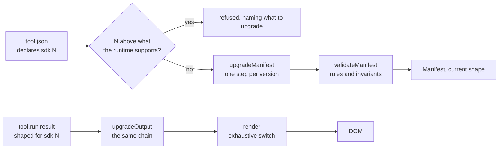

# Versioning and compatibility

The promise: **a tool written today keeps working, unchanged, against every future runtime.**

This document says what that covers, what it does not, and the procedure for raising the contract
version. It is short on purpose. A compatibility policy nobody reads is not a policy.

**Contents**

1. [Three versions, do not confuse them](#1-three-versions-do-not-confuse-them)
2. [What the promise covers](#2-what-the-promise-covers)
3. [Additive only](#3-additive-only)
4. [How it works](#4-how-it-works)
5. [Raising the contract version](#5-raising-the-contract-version)
6. [Worked example: adding a `bytes` output](#6-worked-example-adding-a-bytes-output)
7. [If a breaking change is unavoidable](#7-if-a-breaking-change-is-unavoidable)
8. [Deprecating a tool](#8-deprecating-a-tool)
9. [Version history](#9-version-history)

---

## 1. Three versions, do not confuse them

| Version | Where | Changes when | Example |
|---|---|---|---|
| **Contract version** | `manifest.sdk`, and `SDK_VERSION` in `packages/sdk/src/version.ts` | A new output kind, input type, capability or optional manifest key is added. Rarely, and deliberately | `3` |
| **Package version** | `packages/*/package.json` | Every release, including bug fixes | `0.1.0` |
| **Tool version** | `manifest.version` | The tool author changes the tool. Nothing in the system branches on it | `1.2.0` |

Only the first one is a compatibility boundary. A package release can add a renderer, fix a chart or
rewrite the form code, and no tool notices. Raising the contract version is the only change that
requires a migration and a checklist.

## 2. What the promise covers

A tool declaring `"sdk": 1` will, on every future runtime:

* load and validate;
* have its inputs rendered with the same semantics;
* have its results rendered, possibly better than before;
* pass its own fixtures without those fixtures being edited.

What is explicitly **not** promised:

* **Pixels.** The runtime's visual design will change. If your tool depends on exact spacing, it depends
  on something that was never part of the contract.
* **Extra fields you invented.** Unknown manifest keys are ignored today. A future version may claim a
  key you were using for your own purposes.
* **Internals.** Anything not exported from `@toolbench/sdk` or `@toolbench/runtime` can change in a
  patch release. That includes every module under `render/`.
* **The tool's own correctness.** If your tool was wrong, it stays wrong. The fixtures keep it
  consistent, not correct.

## 3. Additive only

Every contract change must be one of:

* a new member of the `Output` union;
* a new `InputSpec` variant;
* a new optional field on an existing type;
* a new capability;
* a new optional manifest key.

Not allowed, in a contract version bump:

* removing or renaming anything;
* making an optional field required;
* narrowing a type, including narrowing a string to a union of literals;
* changing what an existing field means.

The test of whether a change is additive is mechanical: **write the migration.** If the `manifest` and
`output` halves are both the identity function, the change was additive. If either one has to
transform something, you took something away, and §7 applies.

## 4. How it works

Three mechanisms, and the third is the one that makes the first two mean anything.

**On the way in.** `upgradeManifest` runs before validation. It reads the declared `sdk`, walks the
migration chain up to the current version, and hands the result to `validateManifest`. A manifest
declaring a version higher than the runtime supports is refused with a message saying what to upgrade,
which is a great deal more useful than rendering half of it.

A manifest declaring a version LOWER than a feature it uses is refused too (#170), because the declared
`sdk` is what a host relies on to refuse a tool it cannot fully run: a v4 runtime loads a `"sdk": 4` tool
that uses v6's `lang`, ignores the key, and the reader loses the highlighting with nothing saying why.
`checkManifestFeatures` compares the declared `sdk` with the version that introduced each key, input type,
capability and kind it uses, from the table in `packages/sdk/src/features.ts`, and the message names the
field, its version and the `sdk` to declare. ⚠️ `upgradeManifest` runs it first, because the chain then
stamps the current version over `sdk` and the declaration is gone; so every path that upgrades a manifest
refuses, a host's own included. The tool-directory harness applies the same rule to every case's `expect`
and every sample's result.

**On the way out.** `upgradeOutput` runs on every result, on whichever side produced it, before any
renderer sees it. It takes the tool's declared version so it knows which migrations apply. Renderers
therefore only ever handle current-shaped data.

Old runtimes meeting newer tools is handled too, since that combination exists as soon as anyone caches
a page. The renderer dispatcher's default branch calls `unknownOutput`, which renders "this needs a
newer runtime" rather than nothing at all.

**In CI.** `pnpm test` runs **every** tool's fixtures against the current SDK and runtime. This is the
part that turns the policy into an enforced constraint: a change that breaks an older tool fails the
build, whatever anyone intended.



A manifest and every result are walked up the same chain of migrations to the current shape before
anything validates or draws them, and a manifest newer than the runtime is refused.

The chain holds eight steps today, `1 → 2` to `8 → 9`, and all sixteen of their halves are the identity
function.

It was built before anything needed it, and tested against synthetic versions, which is why the first
real entry was a five-line change rather than a design exercise under pressure. It also caught a bug in
itself while still synthetic: `chainFrom` used the module constant instead of the injected current
version, so chains silently did nothing. That defect would have been invisible until the first real
migration, at which point it would have looked like a compatibility failure rather than a two-line bug.

## 5. Raising the contract version

Six steps. All of them, in one pull request.

⚠️ **One version per release, not per pull request.** A release that adds several contract features raises
the version once: the first pull request to add one does all six steps, and each later one in the same
release extends that version's types, changelog entry, migration note and tests instead of raising it
again. 0.7.0 is the case that set this: twelve additions, which one bump each would have numbered 4 to 15,
so a tool drawing a pie chart would have declared `"sdk": 15` for no reason a reader could use. A version
is what a runtime can read, and a runtime can read everything a release ships or none of it.

1. **`packages/sdk/src/types.ts`** Add the new member, variant or optional field.
2. **`packages/sdk/src/version.ts`** Raise `SDK_VERSION`, append the number to
   `SUPPORTED_SDK_VERSIONS` (it never shrinks), and add a `SDK_CHANGELOG` entry saying what the version
   adds. That entry is data because error messages quote it: a runtime that can read a version can also
   say what that version added, so a refusal explains itself instead of just failing.
3. **`packages/sdk/src/migrate.ts`** Add the `Migration` for the boundary you created. Both halves are
   the identity function if the change was additive. If they are not, stop and read §7.
4. **`packages/sdk/src/features.ts`** A row for everything the version adds, at the new number, in
   `LATER` and in the full table in `features.test.ts`. The runtime ships only `LATER`, the rows after
   version 1, to keep boot small. A test fails on a validator key, input type, capability or kind with no
   row in the full table, and on `LATER` disagreeing with it, but a new optional field inside
   an output has nothing to check against: add it to `OUTPUT_SINCE` and teach `outputFeatureProblem` to
   find it, or a tool can return it under an older `sdk`.
   **`packages/sdk/src/validate.ts`** Validate the new thing, and add any invariant it needs. Ask
   whether a tool using it may still be a live card; anything touching files or the network may not.
5. **`packages/runtime`** Add the renderer or the control. The exhaustive switch in `render/index.ts`
   will not compile until you do. ⚠️ It is not the only one: `summarise` in `element.ts` also switches
   over every kind, because a result has to announce itself to a screen reader. Contract v2 found that
   the hard way. Expect the compiler to point at both.
6. **Tests.** A fixture using the new feature, and a fixture proving an older tool is unaffected.

Then, before merging:

- [ ] `pnpm check` passes
- [ ] `pnpm bench:build && pnpm test:bench` passes
- [ ] **Every existing tool's fixtures pass without being edited.** If one needed editing, the change was
      not additive
- [ ] The migration's two halves are the identity function, or §7 was followed
- [ ] `SDK_CHANGELOG` says what the version adds, in a sentence someone reading an error will understand
- [ ] §9 of this document updated
- [ ] `docs/authoring-a-tool.md` documents the new feature

## 6. Worked example: adding a `bytes` output

⚠️ **This is no longer hypothetical.** It shipped as contract version 2 in 0.2.0, and it is kept here
because it is the shape every future bump should have. The real change matched this sketch almost
exactly; what it added was the discovery that a new output kind also breaks the *host's* exhaustive
switch, not only the renderer's, which is covered in step 5 below.

A hex-dump tool wants a byte grid with offsets, ASCII gutter, and selectable ranges. A `table` can
approximate it and looks wrong.

**types.ts**

```ts
export type Output =
  | /* ... existing members ... */
  | { kind: "bytes"; bytes: number[]; offset?: number; highlight?: ByteRange[]; caption?: string };

// A highlight needs a NAME, not just a span. Colour alone tells a reader something is
// interesting without saying what, and tells a screen reader nothing at all.
export interface ByteRange { at: number; len: number; label: string; tone?: Tone }

export const OUTPUT_KINDS = [/* ... */, "bytes"] as const;
```

**version.ts**

```ts
export const SDK_VERSION = 2;
export const SUPPORTED_SDK_VERSIONS: readonly number[] = [1, 2];
export const SDK_CHANGELOG: Record<number, string> = {
  1: "computation and visualisation: ...",
  2: "byte-oriented output: the bytes kind, for hex dumps and binary formats.",
};
```

**migrate.ts**

```ts
export const MIGRATIONS: readonly Migration[] = [
  {
    from: 1,
    // A v1 manifest cannot mention "bytes", so there is nothing to change.
    manifest: (m) => m,
    // A v1 tool cannot return "bytes" either. Both halves are the identity, which is
    // what an additive change looks like: trivial because nothing was taken away.
    output: (o) => o,
  },
];
```

**runtime** gets `render/bytes.ts` and a `case "bytes"` in the dispatcher.

Now the important part: a tool declaring `"sdk": 1` is unaffected. Its manifest passes through one
identity step, its results pass through another, and its fixtures pass untouched. That is the shape every
version bump should have, and the reason the checklist insists on it.

## 7. If a breaking change is unavoidable

Sometimes the contract is wrong rather than incomplete. In that case:

1. **Say so in the pull request, before writing code.** What is wrong, why an additive change cannot
   fix it, and what breaks.
2. **Add the new form alongside the old one.** Both are supported.
3. **Write a real migration.** The `Migration` halves now do work, and the tests must cover an actual
   old-shaped manifest and an actual old-shaped output.
4. **Deprecate the old form in the changelog**, with the version that will remove it.
5. **Remove it in a major package release**, never in a minor or a patch, and only after at least one
   release where the old form still worked and warned.

`SUPPORTED_SDK_VERSIONS` shrinking is the visible sign that this happened. It should be rare enough to
be memorable.

## 8. Deprecating a tool

A tool, unlike the contract, is allowed to reach the end of its life.

```jsonc
{ "status": "deprecated" }   // still runs; the element shows a marker a host can style
{ "status": "retired" }      // does not run; the element explains and renders links
```

Prefer `retired` over deleting. A URL that someone has bookmarked, or that is linked from a post, should
explain what happened rather than return a 404. If the tool is replaced, put the replacement in `links`.
The runtime honours both values: retired refuses to activate, and deprecated is refused as a live card.
See [authoring-a-tool.md §3b](authoring-a-tool.md#3b-retiring-a-tool).

## 9. Version history

| Contract version | Shipped | Adds |
|---|---|---|
| 1 | Initial | `fields`, `text`, `code`, `table`, `series`, `group`, `error` outputs. `text`, `textarea`, `number`, `select`, `toggle` inputs. The `pure` capability. Main and worker threads. |
| 2 | 0.2.0 | The `bytes` output kind, for wire formats and hex dumps, with named highlight ranges. Both migration halves are the identity function, and every v1 tool's fixtures passed unedited. |
| 3 | 0.4.0 | The optional `samples` manifest key: labelled example inputs a tool ships with, which the runtime draws as a row of buttons under the form. Both migration halves are the identity function, and no existing tool's fixtures were edited. |
| 4 | 0.7.0 | Chart markers: `markers: true` on a line or area series, and the `points` shape, each series in its own marker shape. The `control: "slider"` hint on a number input. A chart readout on hover and keyboard focus, with `readout` and `series.notes` for what it says. Links from a chart to table rows, both ways: `readout.highlightTable`, `chart.id` and `table.link`. Text categories on the x axis. Labelled threshold rules at a y value. Stacked bars. Horizontal bars. The step shape. Log scales on either axis. The band shape. Series with their own x, for scatter plots. Box plots. Two new output kinds, `heatmap` and `pie`. Mirrored horizontal bars. Exploded pie slices. Bubbles. Bubbles, mirrored bars, and three more output kinds, `radar`, `treemap` and `venn`. Both migration halves are the identity function, and no existing tool's fixtures were edited. |
| 5 | 0.8.0 | Names for host stylesheets: an optional `role` on any output part and on any field, rendered as `data-role` (see [STYLING.md](../STYLING.md)). An optional `id` on any part, rendered as `data-part`, which `host.reveal(id)` opens, scrolls to and focuses; fixtures refuse an id used twice in one result. The `muted` tone on fields and table cells, for the routine majority of a dense table. Both migration halves are the identity function, and no existing tool's fixtures were edited. |
| 6 | 0.9.0 | Presets and highlighted inputs. An optional `sets` on a select option, the values choosing that option writes into other inputs, validated like a sample's `input`. The select follows the form afterwards, showing the preset the values match or the first option with no `sets`. An optional `lang` on a textarea, which the host's `highlight` hook paints behind the real textarea; textarea only. Both migration halves are the identity function, and no existing tool's fixtures were edited. |
| 7 | 0.10.0 | Graphs: the `graph` output kind (#152), nodes and edges the runtime lays out and draws. Layered, tree, radial, force and manual layouts in four directions; orthogonal, spline, straight and polyline routing; twelve shapes, record nodes with per-row ports, and crow's-foot and UML markers; nested groups that a reader can close, swimlanes, a highlighted path, and a tool's own `limits`. Structural rules (unique ids, edges and ports that exist, groups without cycles, a group in one lane) are checked by the fixture runner as well as the runtime, through the SDK's `graphProblem`. An optional `grammar` beside a textarea's `lang` (#163): keywords, a comment prefix, operators and string delimiters the runtime tokenises in the paint chunk with no regular expression, capped by validation, with no pattern key; a host hook that paints the `lang` still wins. Both migration halves are the identity function, and no existing tool's fixtures were edited. |
| 8 | 0.14.0 | Faces and form hints. An optional `mono` on a field (#209), `false` to set its value and note in the text face rather than monospace, rendered as `.tb-mono` on the `<dd>` like a table cell; a field with no `mono` is drawn as before. An optional `share` on any input (#211), `false` to keep its value out of the links a host builds from `host.values`, for a credential or pasted private material; a privacy hint, not access control, and an input with no `share` is shareable, as every input was. An optional `role` on any input (#224), rendered as `data-role` on its `.tb-field-row` beside `data-input` and `data-type`, for host stylesheets. An optional `wrap` on a table column and on a cell (#213), `prose` or `none`, rendered as `data-wrap`, so a narrow layout knows which columns are sentences. An optional `rowHeader` on a table column (#214), whose cells render as `<th scope="row">`; with it, a built-in narrow layout for a table that says how its columns wrap, and a shadow at the edge of any table with more to scroll. An optional `details` on any input (#215), the rest of its help behind a native disclosure, outside the control's accessible description. An optional top-level `reset` (#208), `false` to hide the runtime's Reset control. Both migration halves are the identity function, and no existing tool's fixtures were edited. |
| 9 | Unreleased | Native controls. `control: "segmented"` on a select (#203), its options as a row of native radio segments in a fieldset, stacking into plain radios when a segment would cut its label; a v8 select has no `control` and is still a dropdown. `features.ts` dates a value of `control` as well as the key, so a v8 tool asking for segments is refused rather than drawn as a dropdown. The `date` input type, with `mode` `date`, `time` or `datetime` and `min`, `default` and `max` in that mode's format, drawn as the browser's own picker; the runtime refuses a value that does not parse or is out of range before `run`, naming the input, through the SDK's `inputProblem`. Both migration halves are the identity function, and no existing tool's fixtures were edited. |

Planned, in likely order. Nothing here is committed, and each would follow §5:

| Version | Adds | Why it is not in the contract yet |
|---|---|---|
| 9 or later | A `file` input and an `assets` capability | Reading a file means a tool is no longer purely a function of declared inputs. That interacts with seeding, with fixtures, and with whether a tool may be a live card, and each of those needs deciding rather than guessing |
| 9 or later | A `net` capability with an injected `ctx.fetch` | The runtime would have to own the timeout, the abort and the failure rendering. A tool calling `fetch` itself would break cancellation and make fixtures meaningless |
